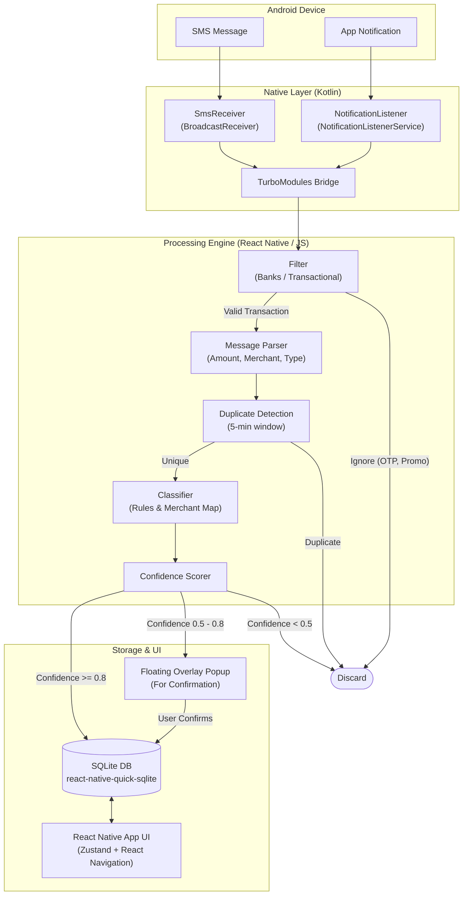

# Expense Tracker Architecture

When starting a new conversation, you can provide the following architecture overview to give me context about the project's structure and data flow.

## High-Level Data Flow

## Tech Stack
* **Mobile App:** React Native (New Architecture)
* **Native Android:** Kotlin
* **Database:** SQLite via `react-native-quick-sqlite`
* **State Management:** Zustand
* **Navigation:** React Navigation 7 (Bottom Tabs)

## Key Project Directories

* `src/core/parser/`: SMS/notification message parsing and filtering rules.
* `src/core/classifier/`: Category assignment based on rules and merchant mappings.
* `src/core/confidence/`: Confidence scoring logic to route transactions.
* `src/core/dedup/`: Duplicate transaction detection to prevent double-counting.
* `src/database/`: SQLite database setup and repository pattern for expense tracking.
* `android/app/src/main/java/com/expensetracker/`: Native Android Kotlin code (receivers, listeners, bridges).
