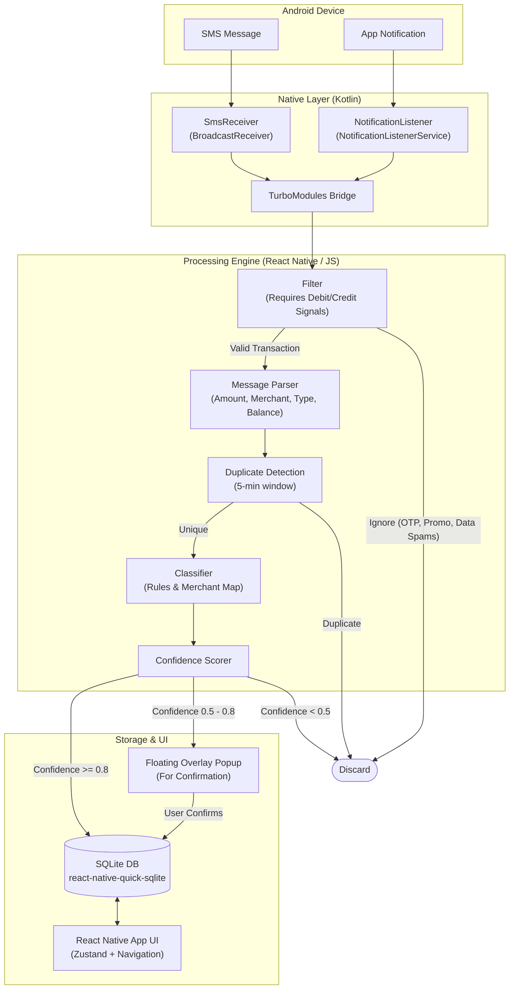

# Expense Tracker Architecture

This document provides a comprehensive overview of the application's structure, native and JS layer boundaries, filtering engine, storage layers, and visual dashboards.

## High-Level Data Flow

---

## Core System Subsystems

### 1. Advanced Message Filtration Upgrade
To prevent spam, messages must pass a strict two-stage filter:
* **Source Validation:** Verify the sender ID matches bank formatting rules or contains known keywords.
* **Signal Validation:** The message must explicitly match a debit keyword (`DEBIT_REGEX`) or a credit keyword (`CREDIT_REGEX`). General carrier reports, promotional items, OTPs, and cellular data usage alerts are discarded.

### 2. Live Accounts & Reconciliation Engine
The Accounts module (`AccountsScreen.tsx`) dynamically reconciles financial statements:
* **Account Grouping:** Groups expenses using a safe unique delimiter (`::`), preventing partition errors.
* **Real-time Balance Adjustment:** Calculates true current balances in real-time by taking the latest parsed balance checkpoint and applying transaction deltas posted after it:
  $$\text{Real-time Balance} = \text{Checkpoint Balance} + \sum \text{Credits} - \sum \text{Debits}$$
* **Anomaly Detection:** Flags reconciliation gaps where actual balances deviate from expected chronological sums, letting users manually record recovery transactions.

### 3. Unified Split Ledger
Splits are grouped under a single **transaction-wide ledger direction**:
* **Simplified UX:** Modals offer a single overall "You owe them" or "They owe you" toggle.
* **Database Alignment:** Preserves normalized schema records by mapping the global toggle to all splits, maintaining 100% backward compatibility.

### 4. Premium Home Screen Dashboard
The homepage is built as a complete personal finance dashboard:
* **Interactive Shortcuts:** Rapid logging for Cash and Pre-built Splits.
* **Bank Cards Carousel:** Slides miniature bank cards detailing real-time balances.
* **Insights Panel:** Displays progress bars depicting top spending categories.

---

## Tech Stack
* **Mobile App:** React Native (New Architecture)
* **Native Android:** Kotlin
* **Database:** SQLite via `react-native-quick-sqlite`
* **State Management:** Zustand
* **Navigation:** React Navigation 7 (Bottom Tabs + Material Top Tabs)

## Key Project Directories
* `src/core/parser/`: SMS/notification message parsing and filtering rules.
* `src/core/classifier/`: Category assignment based on rules and merchant mappings.
* `src/core/confidence/`: Confidence scoring logic to route transactions.
* `src/core/dedup/`: Duplicate transaction detection to prevent double-counting.
* `src/database/`: SQLite database setup and repository pattern for expense tracking.
* `android/app/src/main/java/com/expensetracker/`: Native Android Kotlin code (receivers, listeners, bridges).
