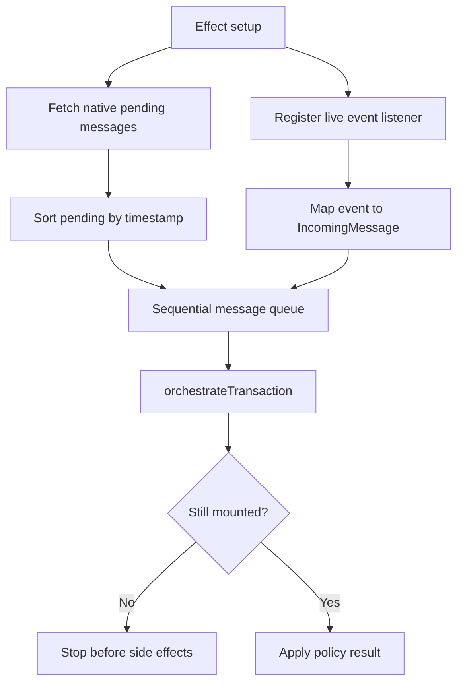
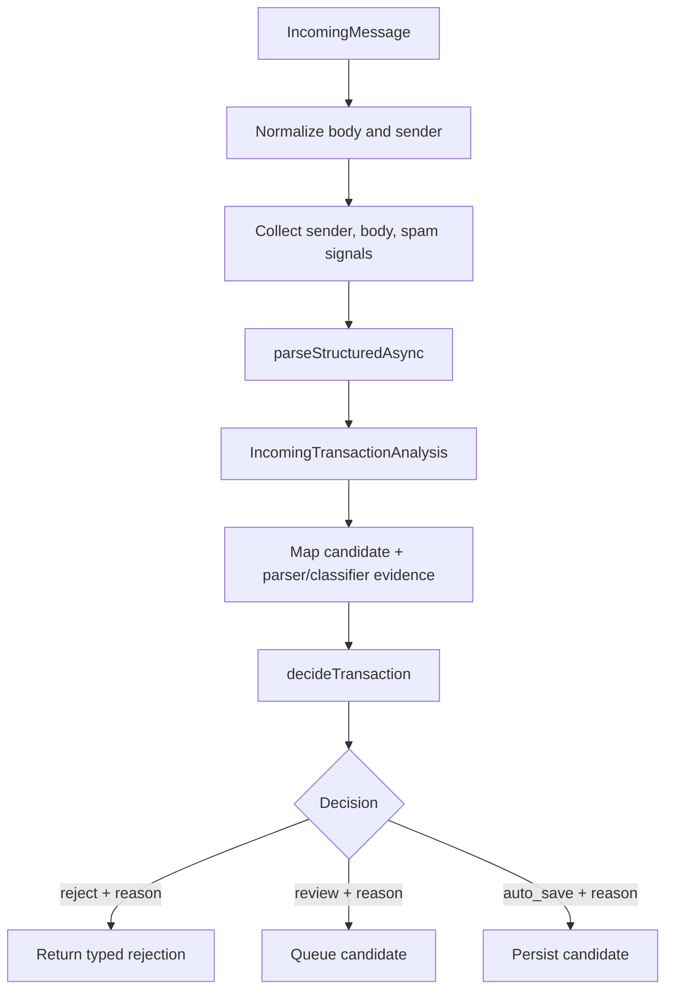

# App startup and message listener flow

This document follows app startup through the live message listener and records the current Phase 2 decision path.

## 1. App startup and listener setup

`AppContent` calls `useMessageListener()` before returning the security-gated navigation tree. The hook starts fetching native pending messages and registers the live message listener in the same effect. The security gate controls displayed children; it does not disable message ingestion.

The effect cleanup marks the listener unmounted and removes the native event subscription. An in-progress async parse checks the mounted flag before making UI/store changes.

## 2. Pending and live message ordering

Live messages wait for the pending-message request to resolve. Pending messages with timestamps are ordered oldest-first and enqueued first; live messages arriving during startup are buffered behind them. Both sources then use the same sequential promise queue. This prevents asynchronous parser enrichment from letting a later repayment credit run ahead of an earlier one.

## 3. Analysis and the single decision policy

`orchestrateTransaction()` awaits `processIncomingMessage()`, which normalizes text, collects sender/body/spam rejection signals, and invokes `parseStructuredAsync()`. It returns an analysis object even when input is rejected or parsing fails, so those cases can receive typed reasons instead of disappearing as `null`.

`processTransaction()` maps the full `StructuredExpense`, classifier category evidence, and the established compatibility confidence score into `TransactionDecisionInput`. It invokes `decideTransaction()` exactly once. The policy returns `reject`, `review`, or `auto_save` with stable reason codes and an evidence summary. It does not persist or update Zustand.

The compatibility thresholds are retained: legacy confidence below `0.5` rejects; `0.5` to below `0.8` reviews; `0.8` and above can auto-save. Parser confidence below `0.5` rejects, and `requiresConfirmation` forces review. Parser confidence, its component breakdown, classifier evidence, parser version, and policy version reach the decision result.

## 4. Applying decisions and persistence outcomes

| Policy decision | Listener action | Persistence behavior |
|---|---|---|
| `reject` | Log the stable reason and stop. | No write. |
| `review` | Queue the candidate and optionally notify in background. | No write before user confirmation. |
| `auto_save` | Call `saveExpense()`. | Duplicate, saved, and failed are separate results. The store updates only after a successful save. |

For accepted credits, `saveExpense()` reads all split-bearing ledger rows, creates the oldest-first partial allocation plan, and commits the repayment credit and all affected split updates in one SQLite transaction. A transaction failure rolls back the credit and split changes; the listener logs the persistence failure separately from the prior auto-save decision.

## 5. Import preview

Settings historical import now uses the same async parsing and decision policy while preparing its preview. The screen still owns import batch deduplication, preview state, and final direct writes. Imported repayments therefore do not yet apply against prior split balances. Phase 3 moves those writes into the shared use case and processes the batch chronologically.

## 6. Correction learning and AI fallback status

When a user explicitly changes a transaction's merchant or category, the legacy store/component calls `LearningEngine.learn()`. The learning repository persists to the merchant-category table that parser resolvers consult.

`parseAsync()` is active in live ingestion and import preview, but its extraction stages still execute synchronously. `AIResolver` has no configured inference handler and AI is disabled by default. Local offline AI fallback remains incomplete; the interface/cache alone are not an active model.

## Source files

- [App.tsx](../App.tsx)
- [useMessageListener.ts](../src/hooks/useMessageListener.ts)
- [messageService.ts](../src/services/messageService.ts)
- [transactionOrchestrator.ts](../src/services/transactionOrchestrator.ts)
- [expenseService.ts](../src/services/expenseService.ts)
- [decisionPolicy.ts](../src/core/transactions/decisionPolicy.ts)
- [expenseRepo.ts](../src/database/expenseRepo.ts)
