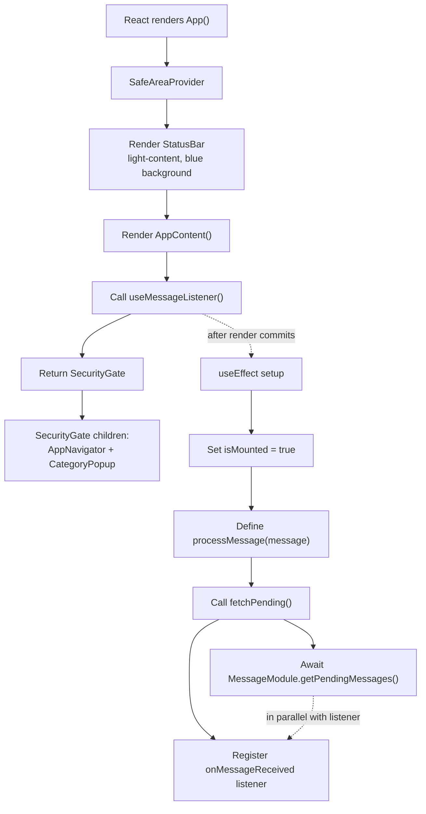
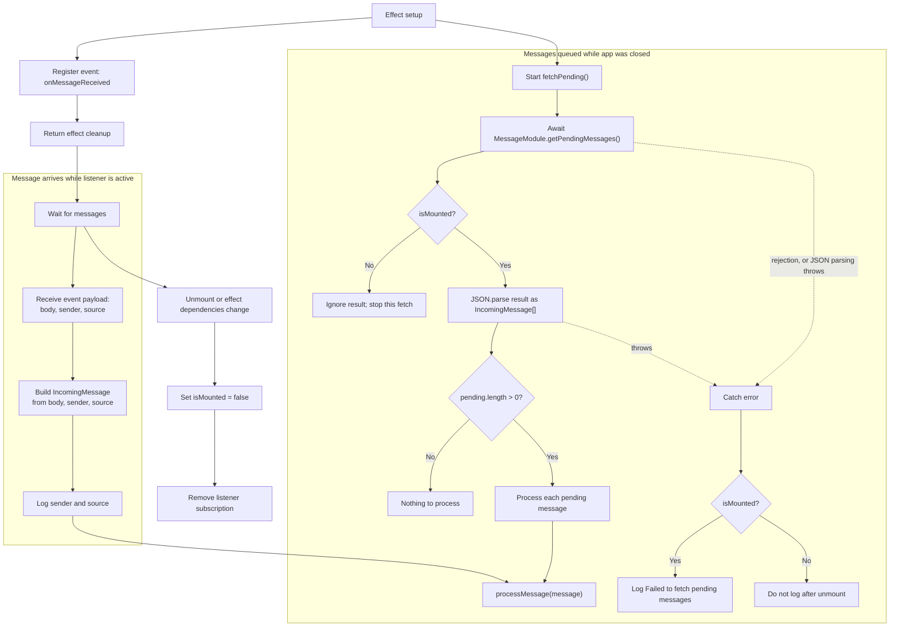
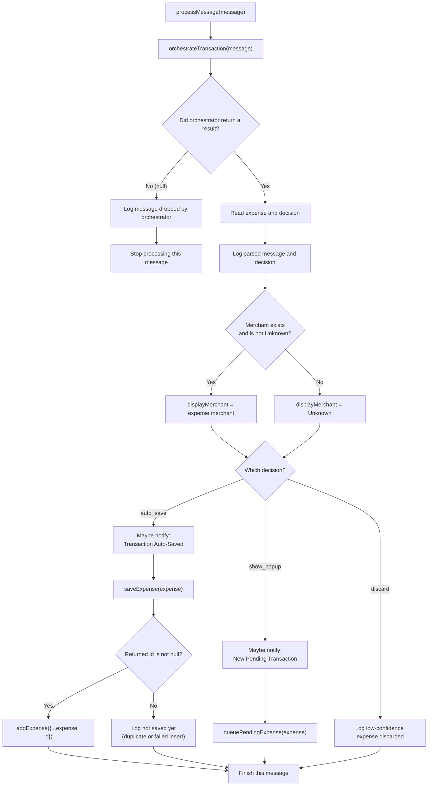
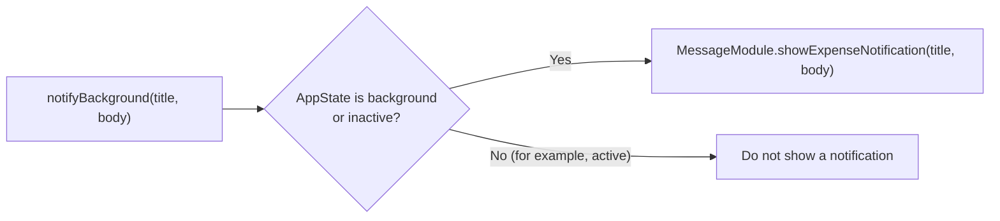

# App startup and message listener flow

This is the first low-level flow slice: it starts at `App.tsx`, follows the
component tree to `useMessageListener()`, and expands the hook's message
handling branches. The diagrams describe the current implementation.

## 1. App startup and hook setup

`useMessageListener()` runs inside `AppContent`, before the returned JSX is wrapped by `SecurityGate`. The gate controls what its children display; it does not conditionally call this hook. The listener therefore starts independently of whether the security gate later shows its lock screen.

The effect has two store selectors in its dependency list: 
`addExpense` and `queuePendingExpense`. If either dependency changes, React runs the cleanup for the prior effect and then sets up the effect again.

## 2. Pending messages and live messages

Both sources are converted to `IncomingMessage` and sent through the same
`processMessage` function.

`fetchPending()` is called without awaiting it. Its native request pauses at `await`, allowing the live event listener to be registered while the pending request is still in progress. Pending messages are processed only if the effect is still mounted when that request resolves.

When the component unmounts or the effect is replaced, cleanup sets `isMounted = false` and removes the event subscription. It does not cancel an already-started native pending-message request; the mounted check prevents that request from processing results after cleanup.

## 3. `processMessage`: orchestrator and decision branches

### Notification branch shared by `auto_save` and `show_popup`

Before either action, `notifyBackground(title, body)` checks
`AppState.currentState`:

The notification text includes the amount and `displayMerchant`. The `auto_save` title is **Transaction Auto-Saved**; the `show_popup` title is **New Pending Transaction** and asks the user to tap to approve.

## 4. What the decision labels mean

The hook receives these labels from `processTransaction()` via
`orchestrateTransaction()`:

| Decision       | Confidence rule                    | Hook action                                           |
| -------------- | ---------------------------------- | ----------------------------------------------------- |
| `discard`    | Below `0.5`                      | Log and stop; no notification, save, or pending queue |
| `show_popup` | At least `0.5` and below `0.8` | Maybe notify in background, then queue for approval   |
| `auto_save`  | At least `0.8`                   | Maybe notify in background, then call `saveExpense` |

An orchestrator result can also be `null`; in that case the hook logs that the message was dropped and does not run a decision branch. The orchestrator returns `null` when message processing rejects the input or transaction processing cannot produce an expense (including a missing amount).

For `auto_save`, `saveExpense()` can return `null` for a duplicate or failed insert. Only a non-null ID is added to the Zustand expense store by this hook. The failed-insert path may queue a database retry inside `saveExpense()`, but this hook logs the null result and does not add it to the store at that point.

## Source files

- [App.tsx](../App.tsx)
- [useMessageListener.ts](../src/hooks/useMessageListener.ts)
- [transactionOrchestrator.ts](../src/services/transactionOrchestrator.ts)
- [messageService.ts](../src/services/messageService.ts)
- [expenseService.ts](../src/services/expenseService.ts)
