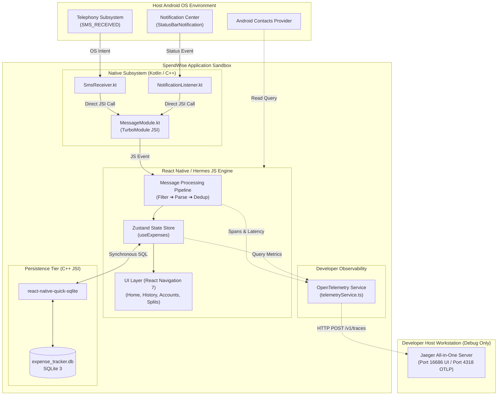
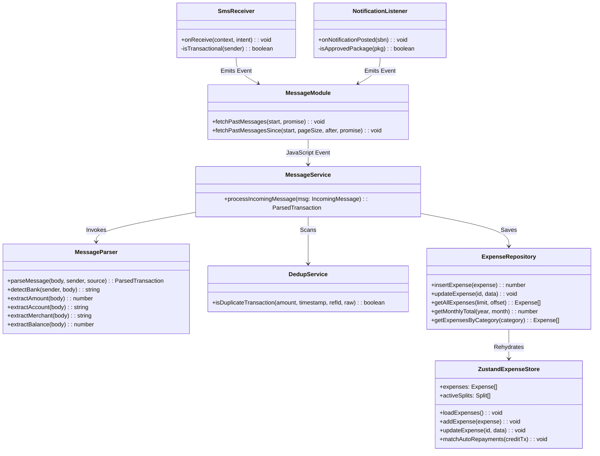
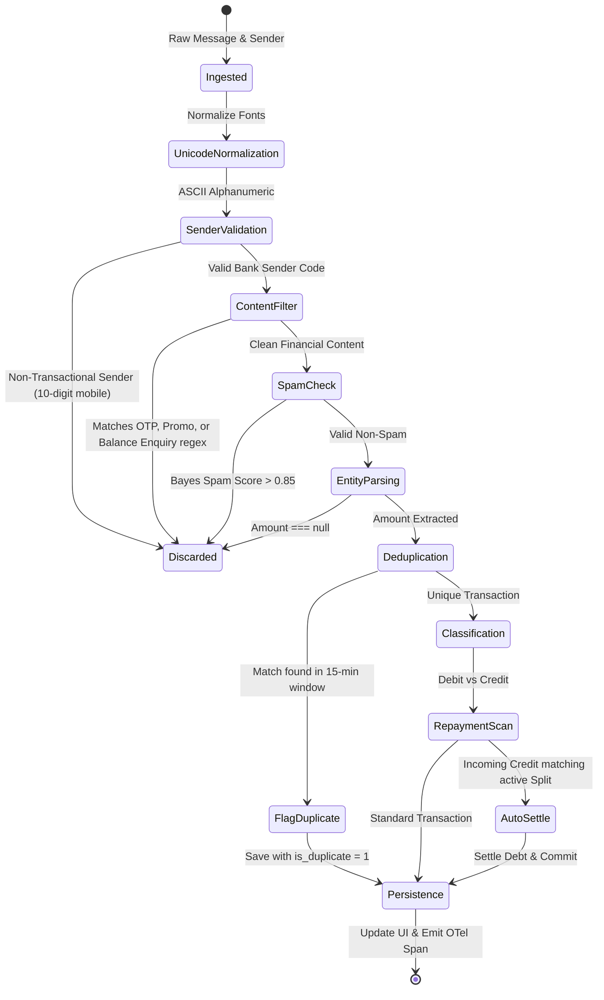
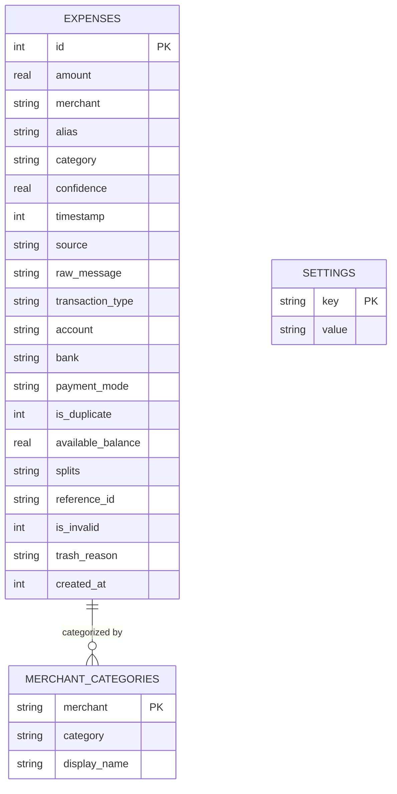

# 🏛️ Architecture Specification (HLD & LLD)

# 📱 Smart Expense Tracker (SpendWise)

| Metadata | Details |
| :--- | :--- |
| **Document Version** | 1.5.0 |
| **Diagram File** | [`docs/architecture.drawio`](file:///home/hrnharshit/Desktop/Projects/expense-tracker/docs/architecture.drawio) (Contains Sheet 1: HLD, Sheet 2: LLD) |
| **System Classification** | Offline-First Event-Driven Mobile Architecture |
| **Last Updated** | October 2026 |

---

## 1. High-Level Design (HLD)

### 1.1 System Context & External Boundaries

The application is an autonomous mobile node with no outbound internet traffic requirements for primary functionality. It interfaces solely with the Android OS broadcast and notification subsystems.



---

### 1.2 Core Architectural Principles

1. **Synchronous Data Access (JSI over Async Bridge)**:
   By using `react-native-quick-sqlite`, SQLite queries execute synchronously directly through the C++ JavaScript Interface (JSI). This prevents the UI frame drops and micro-stutters typical of asynchronous JSON bridge serialization.
2. **Event-Driven Native Waking**:
   The native receivers (`SmsReceiver` and `NotificationListenerService`) are stateless. They intercept raw OS intents, apply structural allowlist checks, wake the application context, hand off the message payload, and release OS wake locks immediately.
3. **Local Bayesian Intelligence**:
   Spam classification runs locally using tokenized frequency probabilities stored in SQLite, adapting to user trashing behavior without external inference APIs.
4. **Zero-Trust Network Isolation**:
   No network libraries (e.g., Axios) are installed. Network capabilities are restricted to developer localhost OTLP telemetry (`127.0.0.1:4318`) active solely in `__DEV__` mode.

---

## 2. Low-Level Design (LLD)

### 2.1 Component Interaction & Class Hierarchy



---

### 2.2 Processing Pipeline State Machine

When a message arrives from either `SmsReceiver` or `NotificationListener`, it passes through a deterministic finite state pipeline:



---

### 2.3 Detailed Subsystem Modules

#### 1. Ingestion Subsystem (`src/services/messageService.ts`)
* **Interface `IncomingMessage`**:
  ```typescript
  export interface IncomingMessage {
    body: string;
    sender: string;
    source: 'sms' | 'notification' | 'manual';
    packageName?: string;
  }
  ```
* **Execution Contract**:
  - Rejects any message where `isTransactionalSender(sender)` is false.
  - Rejects any message where `isTransactionMessage(body)` matches an exclusionary filter (e.g. OTP patterns: `/(?:OTP|verification code|one time password)\b/i`).
  - Runs `parseMessage(cleanBody, cleanSender, source)` returning typed `ParsedTransaction`.

#### 2. Parsing Engine (`src/core/parser/parseMessage.ts`)
* Extracts structured fields using prioritized regular expressions:
  1. **Bank Detection**: Matches sender prefix against `KNOWN_BANKS` table (`AD-ICICIB` ➔ `ICICI`, `VK-SBIIND` ➔ `SBI`, `JX-BOBSMS` ➔ `Bank of Baroda`).
  2. **Amount Normalization**: Strips comma grouping (`1,250.50` ➔ `1250.50`) and validates positive decimal numbers.
  3. **Merchant Resolution**: Identifies payee substrings following markers (`at`, `to`, `transfer to`, `spent on`, `VPA`).
  4. **Reference ID Extraction**: Isolates 12-digit UPI RRN / bank reference numbers for deduplication.

#### 3. Database Layer (`src/database/expenseRepo.ts`)
* Uses pre-compiled SQL string constants to eliminate SQL injection vulnerabilities.
* Wraps all multiline batch queries in explicit SQLite `BEGIN TRANSACTION` / `COMMIT` blocks for atomic consistency.

#### 4. Observability Service (`src/services/telemetryService.ts`)
* Manages an in-memory queue of `RawSpan` records.
* Dispatches traces asynchronously every 2000ms using native `fetch` to local Jaeger OTLP endpoint (`http://127.0.0.1:4318/v1/traces`).
* Safely falls back to Android emulator host alias (`http://10.0.2.2:4318`) if localhost is unreachable.

---

### 2.4 Database Entity Relationship Diagram (ERD)



---

### 2.5 Threading & Concurrency Model

* **Main (UI) Thread**: Dedicated exclusively to React Native layout rendering, gesture handling, and navigation transitions at 60/120 FPS.
* **Hermes JS Thread**: Executes business logic, state mutations, regex parsing, and formatting.
* **Native OS Worker Thread (Kotlin)**: `SmsReceiver` and `NotificationListenerService` execute on Android background worker threads.
* **C++ Quick-SQLite Engine**: Queries execute via JSI directly without thread handoffs, completing typical single-row insertions in under `1.5ms`.
