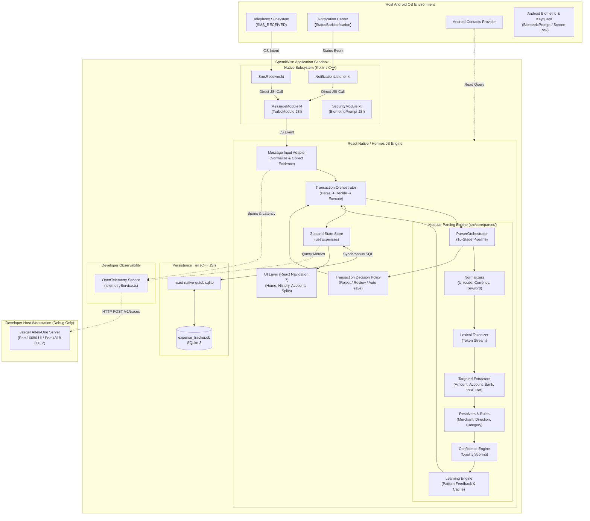
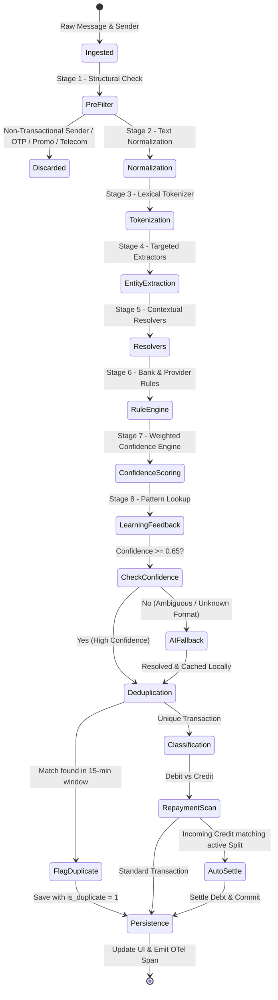
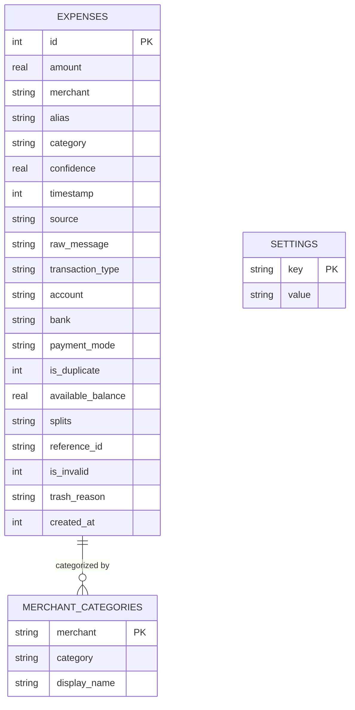

# 🏛️ Architecture Specification (HLD & LLD)

# 📱 Smart Expense Tracker (SpendWise)

| Metadata | Details |
| :--- | :--- |
| **Document Version** | 1.6.0 |
| **Diagram File** | [`docs/architecture.drawio`](file:///home/hrnharshit/Desktop/Projects/expense-tracker/docs/architecture.drawio) (Contains Sheet 1: HLD, Sheet 2: LLD) |
| **System Classification** | Offline-First Event-Driven Mobile Architecture |
| **Last Updated** | October 2026 |

---

## 1. High-Level Design (HLD)

### 1.1 System Context & External Boundaries

The application is an autonomous mobile node with no outbound internet traffic requirements for primary functionality. It interfaces solely with the Android OS broadcast and notification subsystems.



---

### 1.2 Core Architectural Principles

1. **Synchronous Data Access (JSI over Async Bridge)**:
   By using `react-native-quick-sqlite`, SQLite queries execute synchronously directly through the C++ JavaScript Interface (JSI). This prevents UI frame drops and micro-stutters typical of asynchronous JSON bridge serialization.
2. **Event-Driven Native Waking**:
   The native receivers (`SmsReceiver` and `NotificationListenerService`) are stateless. They intercept raw OS intents, apply structural allowlist checks, wake the application context, hand off the message payload, and release OS wake locks immediately (<1% battery consumption).
3. **Data-Driven Modular Parsing (SOLID & Clean Architecture)**:
   Replaces monolithic regex functions with a 10-stage decoupled pipeline. Bank patterns, merchant aliases, token dictionaries, and category rules are managed via declarative JSON schemas (`bankRules.json`, `merchantAliases.json`, `categoryRules.json`), enabling instant onboarding of new financial institutions and UPI apps without source code modifications.
4. **On-Device Correction Learning**:
   Explicit merchant/category corrections are recorded through `LearningEngine` in the local merchant-category repository. Parser resolvers consult those mappings. The current implementation does not include confidence decay or token-pattern frequency learning.
5. **Offline-First Processing**:
   Extraction, spam classification, and correction mappings run locally. `AIResolver` is an interface/cache only: AI is disabled by default and no local inference handler/model is installed. Developer telemetry may use localhost in `__DEV__` mode.

---

## 2. Low-Level Design (LLD)

### 2.1 Component Interaction & Class Hierarchy

```mermaid
classDiagram
    class MessageService {
        +processIncomingMessage(msg: IncomingMessage): Promise~IncomingTransactionAnalysis~
    }

    class ParserOrchestrator {
        -normalizer: Normalizer
        -tokenizer: Tokenizer
        -extractor: EntityExtractor
        -merchantResolver: MerchantResolver
        -transactionResolver: TransactionResolver
        -categoryResolver: CategoryResolver
        -confidenceEngine: ConfidenceEngine
        -learningEngine: LearningEngine
        -aiResolver: AIResolver
        +parse(message: string, sender?: string, source?: string): StructuredExpense
        +parseAsync(message: string, sender?: string, source?: string): Promise~StructuredExpense~
    }

    class Normalizer {
        +normalize(rawText: string): NormalizedMessage
    }

    class Tokenizer {
        +tokenize(normalized: NormalizedMessage): TokenStream
    }

    class EntityExtractor {
        +extractAll(stream: TokenStream, normalized: NormalizedMessage, sender?: string): ExtractedEntities
    }

    class MerchantResolver {
        +resolve(rawMerchant: string, vpa?: string, bank?: string): ResolvedMerchant
    }

    class TransactionResolver {
        +resolve(tokens: Token[], extractedEntities: ExtractedEntities): TransactionTypeResult
    }

    class CategoryResolver {
        +resolve(merchant: string, rawText: string, customCategory?: string): CategoryResult
    }

    class ConfidenceEngine {
        +calculate(entities: ExtractedEntities, resolved: ResolvedData): ConfidenceResult
    }

    class LearningEngine {
        -repository: ILearningRepository
        +lookup(tokenPattern: string): LearnedCorrection?
        +recordCorrection(pattern: string, merchant: string, category: string): Promise~void~
    }

    class AIResolver {
        -cache: AICache
        +resolve(message: string, partial: Partial~StructuredExpense~): Promise~StructuredExpense~
    }

    class StructuredExpense {
        +amount: number
        +transactionType: 'debit' | 'credit'
        +paymentMode: PaymentMode
        +merchant: string
        +category: string
        +bank: string?
        +account: string?
        +availableBalance: number?
        +referenceId: string?
        +confidence: ConfidenceResult
        +source: 'sms' | 'notification' | 'manual'
        +rawMessage: string
    }

    class DedupService {
        +isDuplicateTransaction(amount, timestamp, refId, raw): boolean
    }

    class ExpenseRepository {
        +insertExpense(expense): number
        +updateExpense(id, data): void
        +getAllExpenses(limit, offset): Expense[]
        +getMonthlyTotal(year, month): number
        +getExpensesByCategory(category): Expense[]
    }

    class ZustandExpenseStore {
        +expenses: Expense[]
        +activeSplits: Split[]
        +loadExpenses(): void
        +addExpense(expense): void
        +updateExpense(id, data): void
        +matchAutoRepayments(creditTx): void
    }

    MessageService --> ParserOrchestrator : Delegates Parsing
    ParserOrchestrator --> Normalizer : Step 2
    ParserOrchestrator --> Tokenizer : Step 3
    ParserOrchestrator --> EntityExtractor : Step 4
    ParserOrchestrator --> MerchantResolver : Step 5
    ParserOrchestrator --> TransactionResolver : Step 5
    ParserOrchestrator --> CategoryResolver : Step 5
    ParserOrchestrator --> ConfidenceEngine : Step 6
    ParserOrchestrator --> LearningEngine : Step 7
    ParserOrchestrator --> AIResolver : Fallback
    ParserOrchestrator --> StructuredExpense : Produces
    MessageService --> DedupService : Scans
    MessageService --> ExpenseRepository : Saves
    ExpenseRepository --> ZustandExpenseStore : Rehydrates
```



---

### 2.2 Processing Pipeline State Machine (10-Stage Pipeline)

When a message arrives from either `SmsReceiver` or `NotificationListener`, it passes through a deterministic finite state pipeline:



---

### 2.3 Detailed Subsystem Modules

#### 1. Ingestion Subsystem (`src/services/messaging/messageService.ts`)
* **Interface `IncomingMessage`**:
  ```typescript
  export interface IncomingMessage {
    body: string;
    sender: string;
    source: 'sms' | 'notification' | 'manual';
    packageName?: string;
  }
  ```
* **Execution Contract**:
  - Rejects any message where `isTransactionalSender(sender)` is false.
  - Rejects any message where `isTransactionMessage(body)` matches an exclusionary filter (OTP, telecom alerts).
  - Delegates parsing to `parseMessage(cleanBody, cleanSender, source)` which internally invokes `ParserOrchestrator.parse()`.

#### 2. Modular Parsing Engine (`src/core/parser/`)
The parser follows Clean Architecture principles with complete separation of concerns:

| Submodule | Location | Architectural Responsibility |
| :--- | :--- | :--- |
| **Config Tier** | `src/core/parser/config/` | JSON declarations for 15+ banks (`bankRules.json`), 60+ merchant mappings (`merchantAliases.json`), 8 spending categories (`categoryRules.json`), and lexical keywords (`tokenDictionary.json`). |
| **Models Tier** | `src/core/parser/models/` | Strictly typed `StructuredExpense` entity, `Token` stream definitions, and `ConfidenceResult` contracts. |
| **Normalizer Tier** | `src/core/parser/normalizer/` | Composable pipeline executing Unicode math font conversion (`0x1D400`–`0x1D7FF`), currency token unification (`INR`, `Rs.`, `₹` ➔ `INR`), keyword normalization, and whitespace cleanup. |
| **Tokenizer Tier** | `src/core/parser/tokenizer/` | Lexical analyzer classifying character sequences into typed tokens (`AMOUNT`, `ACCOUNT`, `VPA`, `KEYWORD`, `DATE`, `REF_NUMBER`, `MERCHANT_HINT`, `WORD`, `SEPARATOR`). |
| **Extractor Tier** | `src/core/parser/extractor/` | Targeted extraction units: `AmountExtractor`, `AccountExtractor`, `VpaExtractor`, `ReferenceExtractor`, `BalanceExtractor`, `BankExtractor`, `PaymentModeExtractor`, `RawMerchantExtractor`, unified by `EntityExtractor`. |
| **Resolver Tier** | `src/core/parser/resolver/` | Business heuristics: `MerchantResolver` (cleans UPI garbage, strips bank headers, matches alias registry), `TransactionResolver` (debit vs credit directionality priorities), and `CategoryResolver` (rule-based and learned category assignment). |
| **Confidence Tier** | `src/core/parser/confidence/` | Parser confidence uses configurable weights: amount `0.35`, transaction type `0.25`, merchant `0.20`, category `0.10`, account `0.10`. A separate decision policy consumes parser evidence and the legacy classifier score. |
| **Learning Tier** | `src/core/parser/learning/` | `LearningEngine` stores explicit merchant/category corrections through `ILearningRepository` and the SQLite-backed merchant category table. |
| **AI Tier** | `src/core/parser/ai/` | `AIResolver` and `AICache` define a local fallback boundary, but no inference handler/model is configured and AI remains disabled. |
| **Filter Tier** | `src/core/parser/filter/` | Pre-parsing heuristic message filter (`MessageFilter`) rejecting non-financial alerts. |
| **Orchestrator** | `src/core/parser/orchestrator/` | Coordinates the 10-stage execution pipeline, assembling extracted and resolved entities into `StructuredExpense`. |
| **Legacy Adapter** | `src/core/parser/parseMessage.ts` | Keeps `parseMessage()` for legacy callers and exposes structured synchronous and asynchronous parser entry points for ingestion. |

#### Transaction decision boundary

`src/core/transactions/decisionPolicy.ts` is the sole owner of reject/review/auto-save outcomes. It consumes parser confidence/breakdown/confirmation, category-classifier evidence, and typed sender/body/spam/parse signals. The orchestrator executes the result; duplicate detection and persistence remain subsequent processing steps. Accepted credit insertion and its split allocations use one SQLite transaction.

#### 3. Database Layer (`src/database/expenseRepo.ts`)
* Uses pre-compiled SQL string constants to eliminate SQL injection vulnerabilities.
* Wraps all multiline batch queries in explicit SQLite `BEGIN TRANSACTION` / `COMMIT` blocks for atomic consistency.
* Houses learning repository tables for on-device merchant mapping and category frequency tracking.

#### 4. Observability Service (`src/services/telemetryService.ts`)
* Manages an in-memory queue of `RawSpan` records.
* Dispatches traces asynchronously every 2000ms using native `fetch` to local Jaeger OTLP endpoint (`http://127.0.0.1:4318/v1/traces`).
* Safely falls back to Android emulator host alias (`http://10.0.2.2:4318`) if localhost is unreachable.

#### 5. Security & App Lock Subsystem (`src/services/securityService.ts`, `src/hooks/useSecurityStore.ts`)
* **Cryptographic PIN Storage**: Hashes user PIN with high-entropy cryptographic salt using SHA-256 (`$spendwise$<salt>$<pin>$`), persisting only salt and hash in the SQLite `settings` table.
* **Native Biometric & Screen Lock Bridge (`SecurityModule.kt`)**: Leverages `androidx.biometric.BiometricPrompt` with version-adaptive authenticators (supporting `BIOMETRIC_STRONG | DEVICE_CREDENTIAL` across API 24–36), React Native `LifecycleEventListener` pause/destroy cleanup, and an atomic concurrency lock preventing duplicate prompt collisions.
* **Recent Apps Preview Obscuration (`FLAG_SECURE` & Privacy Shield)**: Configures `WindowManager.LayoutParams.FLAG_SECURE` in `MainActivity.kt` (`onCreate` and `onResume`) and renders an instant privacy veil in `SecurityGate.tsx` during `AppState` transitions. When locked, the underlying app content is isolated with `display: 'none'`, preventing view leakage or task switcher snapshots across OEM launchers.
* **App Lifecycle Gate (`SecurityGate.tsx`)**: Listens to React Native `AppState` transitions with synchronous initial store hydration from SQLite. Auto-locks upon cold start and when backgrounded beyond the configurable auto-lock timeout (Immediately, 30s, 1m, 5m), with hardware `BackHandler` app-minimizing protection.
* **PIN Management UI (`LockScreen.tsx`, `PinSetupModal.tsx`)**: High-performance interactive numpad, animated dot feedback, error shake animations, biometric concurrency guards, and single-touch device authentication.

---

### 2.4 Database Entity Relationship Diagram (ERD)



The `splits` column stores split rows as JSON. Current rows retain the original `amount` and may include cumulative `paidAmount`, `isPaid`, and `owedByMe`. Outstanding balance is calculated from the original amount less paid amount; legacy rows without `paidAmount` remain compatible.

---

### 2.5 Threading & Concurrency Model

* **Main (UI) Thread**: Dedicated exclusively to React Native layout rendering, gesture handling, and navigation transitions at 60/120 FPS.
* **Hermes JS Thread**: Executes business logic, state mutations, regex parsing, and formatting.
* **Native OS Worker Thread (Kotlin)**: `SmsReceiver` and `NotificationListenerService` execute on Android background worker threads.
* **C++ Quick-SQLite Engine**: Queries execute via JSI directly without thread handoffs, completing typical single-row insertions in under `1.5ms`.
