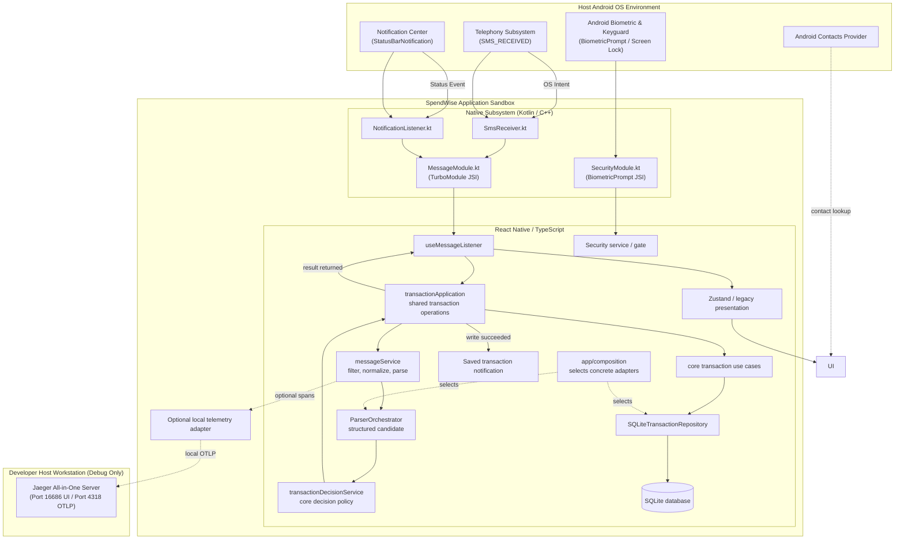
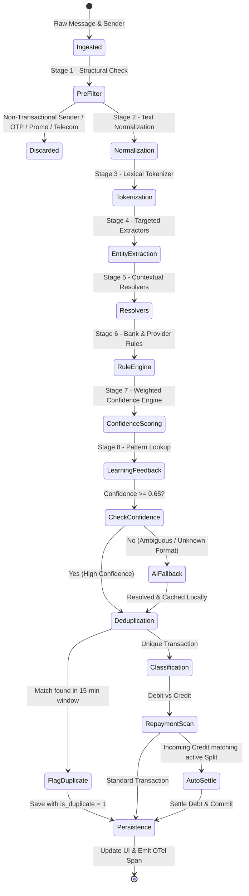
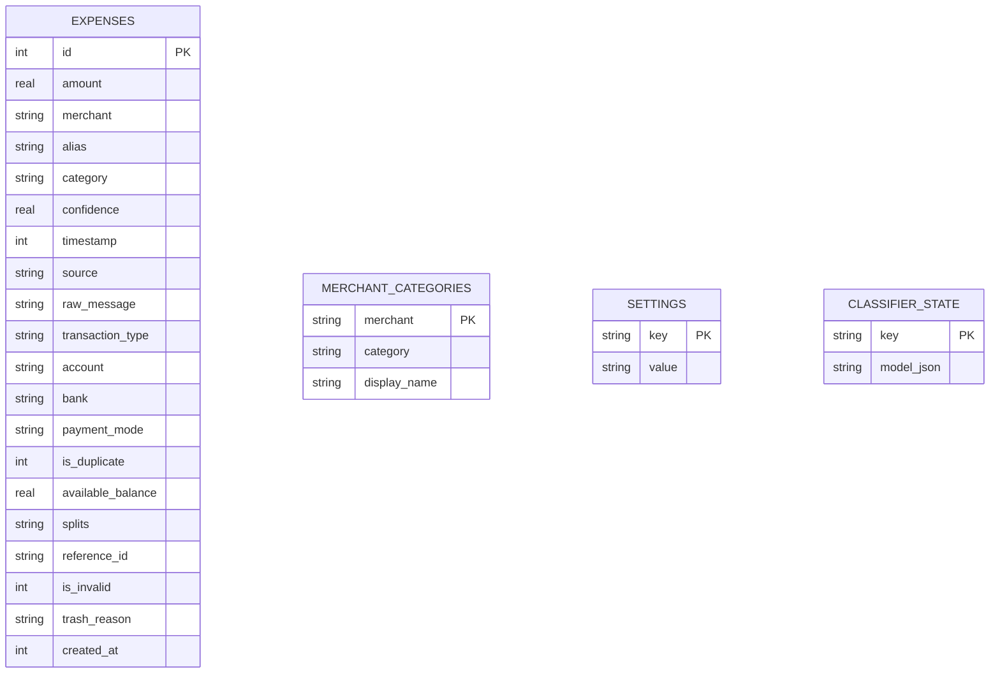

# 🏛️ Architecture Specification (HLD & LLD)

# 📱 Smart Expense Tracker (SpendWise)

| Metadata | Details |
| :--- | :--- |
| **Document Version** | 2.0 (runtime architecture) |
| **Diagram File** | [`docs/architecture.drawio`](./architecture.drawio) is a historical v1 snapshot; the Mermaid diagrams below are current. |
| **System Classification** | Offline-First Event-Driven Mobile Architecture |
| **Last Updated** | October 2026 |

---

## 1. High-Level Design (HLD)

### 1.1 System Context & External Boundaries

Core transaction processing and ledger persistence run locally. In development, optional telemetry can send traces to a locally configured Jaeger collector; no model adapter is active because the catalog remains empty until fine-tuned artifacts are supplied. The local-model library supports verified app-private artifact installation, multi-model inventory, per-task assignments, deterministic-only mode, and a small management screen, with a strict under-100 MB limit. Android SMS and notification listeners provide live message inputs.



---

### 1.2 Core Architectural Principles

1. **Local Persistence**: The SQLite adapter uses `react-native-quick-sqlite`; transaction application operations and repository ports own transaction writes. Performance characteristics should be measured on target devices rather than inferred from JSI alone.
2. **Event-Driven Native Input**: The native SMS receiver and notification listener hand supported events to the React Native `MessageModule`. The JS listener fetches queued messages on startup and serializes processing so timestamped events are not reordered.
3. **Data-Driven Modular Parsing (SOLID & Clean Architecture)**:
   Replaces monolithic regex functions with a 10-stage decoupled pipeline. Bank patterns, merchant aliases, token dictionaries, and category rules are managed via declarative JSON schemas (`bankRules.json`, `merchantAliases.json`, `categoryRules.json`), enabling instant onboarding of new financial institutions and UPI apps without source code modifications.
4. **On-Device Correction Learning**:
   Explicit merchant/category corrections are recorded through `LearningEngine` in the local merchant-category repository. Parser resolvers consult those mappings. The current implementation does not include confidence decay or token-pattern frequency learning.
5. **Offline-First Processing**:
   Extraction, spam classification, local correction learning, and ledger persistence run on-device. The typed model catalog and verified download/library service are groundwork only; the catalog is currently empty and no inference engine is configured. Model preferences are disabled by default. Telemetry is enabled only in `__DEV__` outside tests and targets a local Jaeger endpoint. The current pipeline includes the sender as a telemetry attribute; long strings are truncated, but phone-number redaction is not implemented.

### 1.3 Module ownership and known seams

| Area | Current owner | Current boundary / status |
|---|---|---|
| Domain policy, parser, transaction models | `src/core/` | No SQLite, React Native, presentation, or service imports are permitted by `scripts/check-import-boundaries.js`. |
| Application capabilities | `src/services/` | Organized by messaging, notifications, transactions, settings, security, and advisor capabilities. Two services currently read configured singleton dependencies from app composition. |
| Concrete wiring | `src/app/composition/` | Selects parser, settings, learning, spam, security, and transaction repository adapters. |
| Persistence and platform adapters | `src/database/`, `src/infrastructure/` | SQLite transaction operations stay in the transaction repository; settings, learning, and spam adapters live under infrastructure. |
| Legacy presentation | `src/presentation/legacy/`, `src/hooks/` | Screens/hooks still import service singletons from app composition. Track the deferred work in the [UI replacement issue list](./UI_REPLACEMENT_ISSUES.md). |
| Saved-transaction notifications | `src/services/notifications/transactionSavedNotification.ts` | Localized provider currently imports React Native APIs directly; provider ownership/port is a follow-up. |
| Local model library | `src/services/ai/modelLibraryService.ts`, `src/services/ai/modelRuntimeSelector.ts`, `src/infrastructure/ai/ModelArtifactManager.ts`, `src/presentation/legacy/screens/ModelLibraryScreen.tsx` | Verified catalog install/remove, task-slot assignment, deterministic mode, parser selector seam, and management screen are present. The catalog and adapter registry are empty until final model packages are supplied, so inference remains disabled. |

---

## 2. Low-Level Design (LLD)

### 2.1 Historical v1 class diagram (not current runtime)

The following class model predates the shared application-use-case and repository boundaries. Use the current HLD above and [live message flow](./APP_MESSAGE_LISTENER_FLOW.md) for present-day call paths.


---

### 2.2 Historical v1 processing diagram (not current runtime)

This diagram is retained as a record of the earlier design. It shows AI fallback and dedup/persistence stages that do not match the current live runtime. The current parser/decision/persistence flow is documented in [live message flow](./APP_MESSAGE_LISTENER_FLOW.md).

When a message arrives from either `SmsReceiver` or `NotificationListener`, it passes through a deterministic finite state pipeline:



---

### 2.3 Detailed Subsystem Modules

#### 1. Ingestion and transaction application
* **Interface `IncomingMessage`**:
  ```typescript
  export interface IncomingMessage {
    body: string;
    sender: string;
    source: 'sms' | 'notification' | 'manual';
    packageName?: string;
  }
  ```
* **Current live path**: `useMessageListener` maps native events to `IncomingMessage`, orders startup pending events before queued live events, and calls `ingestLiveMessage()`.
* **Analysis**: `messageService.processIncomingMessage()` normalizes text, gathers sender/body/spam rejection signals, invokes the composed `ParserOrchestrator.parseAsync()`, and returns structured evidence.
* **Decision**: `transactionDecisionService.processTransaction()` maps parser and classifier evidence into the one `decideTransaction()` policy. The policy returns reject, review, or auto-save with typed reasons.
* **Application and persistence**: `transactionApplication.ts` runs shared core use cases through the composed `TransactionRepository`. The hook updates Zustand after a successful write. Successful transaction writes request a best-effort local notification.

#### 2. Modular Parsing Engine (`src/core/parser/`)
The parser follows Clean Architecture principles with complete separation of concerns:

| Submodule | Location | Architectural Responsibility |
| :--- | :--- | :--- |
| **Config Tier** | `src/core/parser/config/` | Declarative bank/provider patterns, merchant aliases, category rules, and lexical keywords. Configured rules are examples of coverage, not a guarantee for all provider formats. |
| **Models Tier** | `src/core/parser/models/` | Strictly typed `StructuredExpense` entity, `Token` stream definitions, and `ConfidenceResult` contracts. |
| **Normalizer Tier** | `src/core/parser/normalizer/` | Composable pipeline executing Unicode math font conversion (`0x1D400`–`0x1D7FF`), currency token unification (`INR`, `Rs.`, `₹` ➔ `INR`), keyword normalization, and whitespace cleanup. |
| **Tokenizer Tier** | `src/core/parser/tokenizer/` | Lexical analyzer classifying character sequences into typed tokens (`AMOUNT`, `ACCOUNT`, `VPA`, `KEYWORD`, `DATE`, `REF_NUMBER`, `MERCHANT_HINT`, `WORD`, `SEPARATOR`). |
| **Extractor Tier** | `src/core/parser/extractor/` | Targeted extraction units: `AmountExtractor`, `AccountExtractor`, `VpaExtractor`, `ReferenceExtractor`, `BalanceExtractor`, `BankExtractor`, `PaymentModeExtractor`, `RawMerchantExtractor`, unified by `EntityExtractor`. |
| **Resolver Tier** | `src/core/parser/resolver/` | Business heuristics: `MerchantResolver` (cleans UPI garbage, strips bank headers, matches alias registry), `TransactionResolver` (debit vs credit directionality priorities), and `CategoryResolver` (rule-based and learned category assignment). |
| **Confidence Tier** | `src/core/parser/confidence/` | Parser confidence combines extraction/resolution signals and reports confirmation requirements. A separate transaction policy consumes parser evidence and classifier confidence. |
| **Learning Tier** | `src/core/parser/learning/` | `LearningEngine` stores explicit merchant/category corrections through `ILearningRepository`; the standalone parser uses in-memory learning, while production composition selects the SQLite adapter in `src/infrastructure/persistence/sqlite/`. |
| **AI Tier** | `src/core/parser/ai/` | `AIResolver` and an in-memory `AICache` define an optional inference boundary. AI is disabled by default and no inference handler/model is configured in app composition. |
| **Filter Tier** | `src/core/parser/filter/` | Pre-parsing heuristic message filter (`MessageFilter`) rejecting non-financial alerts. |
| **Orchestrator** | `src/core/parser/orchestrator/` | Coordinates the 10-stage execution pipeline, assembling extracted and resolved entities into `StructuredExpense`. |
| **Legacy Adapter** | `src/core/parser/parseMessage.ts` | Keeps `parseMessage()` for legacy callers and exposes structured synchronous and asynchronous parser entry points for ingestion. |

#### Transaction decision boundary

`src/core/transactions/decisionPolicy.ts` is the sole owner of reject/review/auto-save outcomes. `transactionDecisionService.ts` maps parser output, category-classifier evidence, and typed rejection signals into its input. `transactionApplication.ts` executes shared use cases and persists through the composed repository. Accepted credit insertion and its split allocations use one SQLite transaction.

#### 3. Database Layer (`src/database/`)
* `src/database/SQLiteTransactionRepository.ts` implements the transaction, backup, query, and maintenance ports; it owns the concrete SQLite adaptation.
* `expenseRepo.ts` contains low-level SQL, row mapping, and transaction helpers. Transaction writes from application operations and temporary presentation adapters enter through `transactionApplication.ts` and the composed repository.
* Backup append/overwrite and clear-all operations run transactionally. Overwrite restore replaces expense rows only, preserving app settings and learned merchant mappings; snapshot split payments are restored as stored without repayment replay.
* `src/infrastructure/persistence/sqlite/SQLiteLearningRepository.ts` implements parser correction-learning persistence. Spam classifier state and general settings use separate SQLite settings adapters.

#### 4. Observability Adapter (`src/infrastructure/observability/telemetryService.ts`)
* Manages an in-memory queue of `RawSpan` records.
* Dispatches traces asynchronously every 2000ms using native `fetch` to local Jaeger OTLP endpoint (`http://127.0.0.1:4318/v1/traces`).
* Safely falls back to Android emulator host alias (`http://10.0.2.2:4318`) if localhost is unreachable.
* Telemetry is disabled in tests and outside `__DEV__`; it is optional developer instrumentation, not a remote production analytics service.

#### 5. Security & App Lock Subsystem (`src/services/security/securityService.ts`, `src/hooks/useSecurityStore.ts`)
* **Cryptographic PIN Storage**: Hashes user PIN with high-entropy cryptographic salt using SHA-256 (`$spendwise$<salt>$<pin>$`), persisting only salt and hash in the SQLite `settings` table.
* **Native Biometric & Screen Lock Bridge (`SecurityModule.kt`)**: Leverages `androidx.biometric.BiometricPrompt` with version-adaptive authenticators (supporting `BIOMETRIC_STRONG | DEVICE_CREDENTIAL` across API 24–36), React Native `LifecycleEventListener` pause/destroy cleanup, and an atomic concurrency lock preventing duplicate prompt collisions.
* **Recent Apps Preview Obscuration (`FLAG_SECURE` & Privacy Shield)**: Configures `WindowManager.LayoutParams.FLAG_SECURE` in `MainActivity.kt` (`onCreate` and `onResume`) and renders an instant privacy veil in `SecurityGate.tsx` during `AppState` transitions. When locked, the underlying app content is isolated with `display: 'none'`, preventing view leakage or task switcher snapshots across OEM launchers.
* **App Lifecycle Gate (`SecurityGate.tsx`)**: Listens to React Native `AppState` transitions with synchronous initial store hydration from SQLite. Auto-locks upon cold start and when backgrounded beyond the configurable auto-lock timeout (Immediately, 30s, 1m, 5m), with hardware `BackHandler` app-minimizing protection.
* **PIN Management UI (`LockScreen.tsx`, `PinSetupModal.tsx`)**: High-performance interactive numpad, animated dot feedback, error shake animations, biometric concurrency guards, and single-touch device authentication.

---

### 2.4 Database Entity Relationship Diagram (ERD)



The diagram lists coexisting tables; it does not imply a foreign-key relationship between expenses and merchant mappings. The current spam adapter stores its model under the settings key `spam_classifier_state`; the schema still creates `classifier_state`, which has no current application reader/writer.

The `splits` column stores split rows as JSON. Current rows retain the original `amount`, a stable `splitId`, and compatibility summaries (`paidAmount`, `isPaid`, and `owedByMe`). `manualPaidAmount` tracks explicit manual settlement; `repaymentPaidAmount` tracks active automatic repayment allocations. New repayment credit splits store exact `{expenseId, splitId, amount}` allocation links. This lets core use cases reverse or re-plan new repayments atomically without confusing them with manual settlement. Legacy rows without allocation metadata remain readable; unsafe mutation of legacy repayment credits is blocked instead of guessing which debt they paid. Backup restore remaps allocation expense IDs while preserving split state.

---

### 2.5 Threading & Concurrency Model

* **Main (UI) Thread**: Dedicated exclusively to React Native layout rendering, gesture handling, and navigation transitions at 60/120 FPS.
* **Hermes JS Thread**: Executes business logic, state mutations, regex parsing, and formatting.
* **Native OS Worker Thread (Kotlin)**: `SmsReceiver` and `NotificationListenerService` execute on Android background worker threads.
* **SQLite access**: Database calls are made through the Quick-SQLite adapter. Latency depends on device and operation; no fixed insertion latency is promised here.
