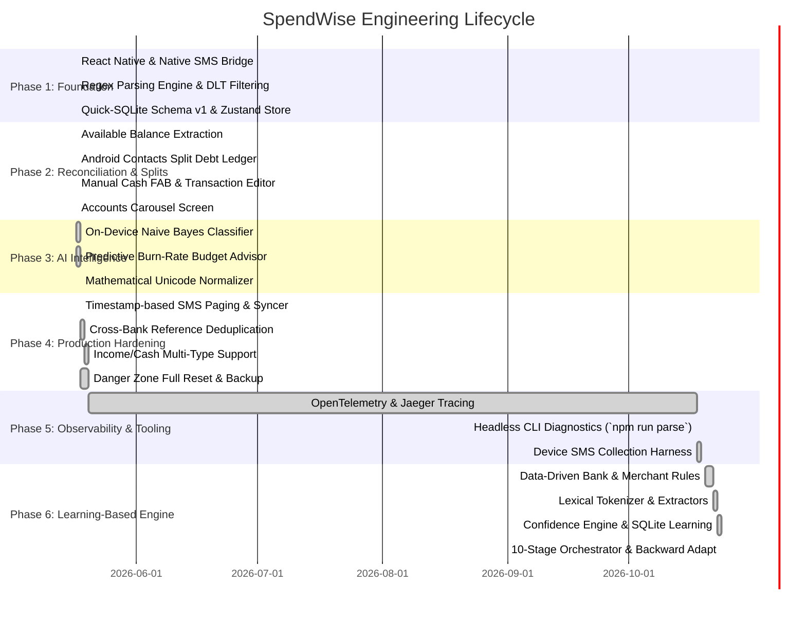

# SpendWise: Historical v1 Implementation Record and Roadmap

> **Document status:** The dated v1 phase breakdown below is a historical implementation record, not the current development status or authoritative runtime description. Current phase status is tracked in the [v2 architecture restructuring plan](./v2.0%20-%20improvement_plan/ARCHITECTURE_RESTRUCTURING_PLAN.md); current behavior is documented in [Architecture](./ARCHITECTURE.md) and [Live Message Flow](./APP_MESSAGE_LISTENER_FLOW.md). Historical verification counts and paths describe the revision at that time.

## 1. Executive Overview & Methodology

The original v1 implementation followed a progressive hardening lifecycle, transitioning from a regex-based SMS parser to a local transaction ledger. This section records those milestones; it does not imply that every planned or historical claim remains active in the current code.

The implementation strategy adheres to four core engineering tenets:

1. **Local Core Processing**: Transaction parsing and storage run on-device. Optional developer telemetry can target a local Jaeger collector; no AI inference runtime is currently configured.
2. **Native Asynchronous Offloading**: High-throughput Android Telephony ContentResolver querying decoupled from the React Native JS thread.
3. **Data Integrity & Determinism**: ACID-compliant local relational persistence with schema migration safeguards and idempotent deduplication.
4. **Developer Operability**: Automated test-case collection from physical hardware, headless CLI diagnostics, and distributed OpenTelemetry tracing.

---

## 2. Chronological Implementation Phases

---

## 3. Phase-by-Phase Technical Breakdown

### Phase 1: MVP & Core Ingestion Pipeline (v1.0.3 - v1.0.4)

* **Goal**: Establish the basic capability to read local SMS, detect debits/credits via regular expressions, and persist records in local SQLite.
* **Key Deliverables**:
  - `android/.../MessageModule.kt`: Custom React Native native module querying Android's `Telephony.Sms.CONTENT_URI` with projected columns (`_id`, `address`, `body`, `date`, `read`).
  - `src/services/sms/parser.ts`: Initial regex patterns for parsing amount (`(?:rs\.?|inr)\s*([\d,]+(?:\.\d{2})?)`), transaction type (`debited|spent|paid` vs `credited|deposited`), merchant (`at|to|vpa\s+([\w\s]+)`), and account number (`(?:ac|a/c|card|acct)\s*no\.?\s*([x\d]+)`).
  - `src/services/sms/filter.ts`: TRAI DLT alphanumeric header filter (e.g., `VM-HDFCBK`, `AD-SBIINB`, `BP-KOTAKB`) and OTP rejection filter (`otp|one time password|verification code`).
  - `src/services/db/db.ts`: SQLite database initialization utilizing `react-native-quick-sqlite` for sub-millisecond synchronous C++ JSI bindings.
  - `src/store/useExpenseStore.ts`: Centralized state management via Zustand storing parsed transactions and current month aggregates.
* **Verification Criteria**: Successfully ingest 100 SMS messages in under 500ms on a standard Android emulator with accurate debit detection.

---

### Phase 2: Reconciliation, Splits & Accounts (v1.1.0 - v1.2.0)

* **Goal**: Transition from a passive expense log to an active financial ledger supporting multi-account tracking, peer debt splits, and manual cash adjustments.
* **Key Deliverables**:
  - `src/screens/AccountsScreen.tsx` & `src/components/AccountsSlider.tsx`: Visual carousel of detected financial institutions, displaying individual available balances, last transaction timestamp, and net account breakdown.
  - `src/screens/SplitLedgerScreen.tsx` & `src/services/db/splitsRepo.ts`: Peer-to-peer split tracker integrating Android Contacts (`react-native-contacts`) allowing users to split transactions, calculate owed vs owing balances, and mark splits settled.
  - `src/components/EditTransactionModal.tsx` & `src/components/AddExpenseFAB.tsx`: Floating Action Button and modal interface allowing manual entry of cash expenses and manual overrides for category, merchant, or notes.
  - Schema Migration v2: Added `available_balance`, `reference_id`, `is_invalid`, `split_with`, and `split_settled` columns to `expenses` table.
* **Verification Criteria**:
  - Running balance extraction across ICICI, HDFC, SBI, BOB, and Axis Bank alerts with >90% extraction accuracy.
  - Seamless split calculation where an expense divided 50/50 deducts only the user's portion from net monthly spending.

---

### Phase 3: AI Intelligence & Unicode Normalization (v1.2.1 - v1.4.0)

* **Goal**: Eliminate false positives from transactional spam, provide predictive burn-rate warnings, and parse promotional unicode fonts.
* **Key Deliverables**:
  - `src/services/ai/spamClassifier.ts`: On-device Naive Bayes probabilistic classifier trained on financial SMS vocabulary (tokenized unigrams and bigrams). Computes log probabilities to classify messages as `TRANSACTION`, `SPAM_PROMO`, or `UNKNOWN`.
  - `src/services/ai/budgetAdvisor.ts`: Deterministic burn-rate predictive algorithm calculating:

    $$
    \text{Burn Rate} = \frac{\text{Total Spent in Month}}{\text{Days Elapsed}}
    $$

    $$
    \text{Projected Spend} = \text{Burn Rate} \times \text{Days in Month}
    $$

    Generates actionable financial warnings (e.g., "At current rate of ₹1,450/day, you will exceed your ₹40,000 budget by the 22nd").
  - `src/services/sms/unicode.ts`: Mathematical font normalization mapping stylized Unicode characters (Mathematical Bold, Sans-Serif, Script used by brands like Swiggy, Zomato, and Cred) back to standard ASCII `[A-Za-z0-9]`.
* **Verification Criteria**:
  - Spam classifier rejects 99% of promotional credit card offers and loan solicitations.
  - Unicode normalizer translates `₹ 𝟓𝟒𝟗 𝐝𝐞𝐛𝐢𝐭𝐞𝐝` to standard ASCII `₹ 549 debited` with 100% regex fidelity.

---

### Phase 4: Production Hardening & High-Fidelity Sync (v1.3.1 - v1.5.0)

* **Goal**: Prevent message sync timeouts on devices with 10,000+ messages, resolve multi-SMS debit/credit duplicate records, and support income logging.
* **Key Deliverables**:
  - `src/services/sms/syncer.ts`: Timestamp-based paging querying native Android SMS in rolling 30-day batches using cursor offsets, with persistent checkpointing in `settings` table (`last_sms_sync_timestamp`).
  - `src/services/sms/dedup.ts`: Multi-stage deduplication:
    - Exact hash matching: `MD5(account + amount + timestamp)`.
    - UPI Reference ID matching (`UPI-Ref: 312345678901`).
    - Sliding window fuzzy match: Matching SMS received within 180 seconds bearing identical amount and merchant token.
  - `src/services/sms/orchestrator.ts`: Unified pipeline coordinating normalization, classification, regex extraction, deduplication, auto-repayment detection, and repository insertion.
  - Multi-Type Transaction Support: Support for `DEBIT`, `CREDIT`, `TRANSFER`, and `CASH` across queries, filters, and analytics.
* **Verification Criteria**:
  - Paged synchronization runs smoothly on phones with 5,000+ total SMS without freezing the UI or exceeding 35MB RAM footprint.
  - Duplicate notification vs SMS events correctly de-duplicated to a single database entry.

---

### Phase 5: Observability, Diagnostics & Real Hardware Testing (Historical milestone)

* **Goal**: Provide enterprise-grade telemetry, automated physical device testing harnesses, and headless debugging scripts.
* **Key Deliverables**:
  - `src/infrastructure/observability/telemetryService.ts`: Development-only OpenTelemetry adapter sending OTLP spans to a local Jaeger collector. Current spans include message processing and selected `db.*` repository calls; see `docs/ARCHITECTURE.md` for the current attributes and privacy limitation.
  - `scripts/jaeger/`: Standalone Jaeger binary deployment with npm management scripts (`npm run jaeger:start`, `npm run jaeger:stop`).
  - `scripts/collect-testcases.py`: Python ADB automation harness that queries physical Android devices (`adb shell content query --uri content://sms`), strips personal phone numbers for privacy, and generates executable Jest test suites (`src/__tests__/collected-real.test.ts`).
  - `scripts/parse-sms.sh` & `npm run parse`: Headless parser diagnostic runner.
* **Historical verification target**: This milestone's original device-sample and Jaeger checks are retained as historical targets; use current commands in `docs/TESTING_STRATEGY.md` for the checked-out revision.

---

### Phase 6: Generic & Learning-Based Parsing Engine (v1.6.0)

* **Goal**: Modernize parsing from brittle monolithic regexes to a Clean Architecture 10-stage pipeline that is data-driven, modular, self-learning, and zero-code extensible for 15+ banks, UPI apps, wallets, and future institutions.
* **Key Deliverables**:
  - `src/core/parser/config/`: Declarative JSON schemas (`bankRules.json`, `merchantAliases.json`, `categoryRules.json`, `tokenDictionary.json`).
  - `src/core/parser/normalizer/`: Composable normalization pipeline (`unicodeNormalizer`, `currencyNormalizer`, `keywordNormalizer`, `whitespaceNormalizer`).
  - `src/core/parser/tokenizer/`: Lexical token classifier preserving token streams and character offsets.
  - `src/core/parser/extractor/`: Targeted extractors (`AmountExtractor`, `AccountExtractor`, `BankExtractor`, `VpaExtractor`, `ReferenceExtractor`, `BalanceExtractor`, `PaymentModeExtractor`, `RawMerchantExtractor`) coordinated via `EntityExtractor`.
  - `src/core/parser/resolver/`: Contextual business resolvers (`MerchantResolver`, `TransactionResolver`, `CategoryResolver`).
  - `src/core/parser/confidence/`: Weighted multi-factor confidence scoring engine.
  - `src/core/parser/learning/`: Adaptive on-device learning engine (`LearningEngine`) with repository abstraction (`ILearningRepository`, `InMemoryLearningRepository`); its SQLite adapter lives in `src/infrastructure/persistence/sqlite/`.
  - `src/core/parser/ai/`: Optional inference interface (`AIResolver`) with a bounded in-memory `AICache`; this historical interface has no configured production handler/model.
  - `src/core/parser/orchestrator/`: 10-stage pipeline coordinator (`ParserOrchestrator`).
  - `src/core/parser/parseMessage.ts`: Backward compatibility adapter returning typed `ParsedTransaction`.
* **Historical verification snapshot**: The 599-test/22-suite figure and institution list describe the v1.6.0 milestone, not the current test count or a guarantee of provider coverage. Run the current test suite and inspect configured rules before claiming support.

---

## 4. Work Breakdown Structure (WBS) & Responsibility Matrix

| Module                          | Core Files                                                       | Responsibility                                                   | Dependencies                  |
| :------------------------------ | :--------------------------------------------------------------- | :--------------------------------------------------------------- | :---------------------------- |
| **Android Native Bridge** | `android/.../MessageModule.kt`, `MessagePackage.kt`          | Cursor pagination, contact lookup, SMS listener                  | Android SDK 34, Kotlin        |
| **Modular Parsing Engine**| `src/core/parser/*` (`config`, `normalizer`, `tokenizer`, etc.) | 10-stage pipeline, tokenization, entity extraction, resolvers    | Pure TypeScript               |
| **Confidence & Learning** | `src/core/parser/confidence/`, `learning/`, `ai/` | Confidence, repository-backed correction learning, optional inference interface | TypeScript; persistence adapter selected in app composition |
| **Spam Classifier** | `src/core/classifier/spamClassifier.ts` | Naive Bayes scoring/training behind a state repository | Pure model logic plus SQLite adapter |
| **Budget Advisor** | `src/services/advisor/advisorService.ts` | Deterministic budget insights | TypeScript |
| **Persistence Engine** | `src/database/`, `src/infrastructure/persistence/sqlite/` | SQLite queries, transaction repository, settings/learning adapters, migrations | `react-native-quick-sqlite` |
| **State Layer** | `src/hooks/` | Temporary Zustand stores and UI-facing state actions | Zustand |
| **Legacy UI Components** | `src/presentation/legacy/{screens,components,styles,navigation}/` | Existing React Native presentation retained as a replaceable adapter | React Native Core |
| **Telemetry & QA**        | `src/infrastructure/observability/telemetryService.ts`, `scripts/collect-testcases.py` | Local development traces and optional device fixture extraction | OpenTelemetry, ADB, Python |

---

## 5. Technical Risk Analysis & Mitigation

| Identified Risk                                   | Severity | Probability | Mitigation Strategy                                                                                                                      |
| :------------------------------------------------ | :------: | :---------: | :--------------------------------------------------------------------------------------------------------------------------------------- |
| **Google Play SMS Permissions Rejection**   | Critical |    High    | Maintain strict separation of financial analysis; distribute via GitHub Releases and F-Droid; avoid non-essential permissions.           |
| **Manufacturer Battery Aggressive Killing** |   High   |    High    | Rely on explicit foreground sync on app resume rather than untrusted background wake-locks (`READ_SMS` sync on startup).               |
| **Irregular Bank SMS Templates**            |   High   |   Medium   | Continuous automated test collection (`npm run test:collect`) across varied user devices; extensible bank regex maps.                  |
| **SQLite DB Corruption on Power Loss**      |  Medium  |     Low     | Enable SQLite WAL (Write-Ahead Logging) mode; atomic transaction wrapping for batch insertions.                                          |
| **Large Message Sync UI Freezes**           |   High   |   Medium   | Implemented cursor pagination with chunked processing (100 messages/batch) and cooperative event-loop yielding (`setTimeout(..., 0)`). |

---

## 6. Future Capability Candidates (Unscheduled)

Receipt OCR, additional historical import formats, backup providers, notification providers, multi-currency, and the replacement UI are candidate capabilities, not approved delivery milestones. Their extension points, reuse requirements, and decisions that need product input are documented in the [Feature Extension Guide](./FEATURE_EXTENSION_GUIDE.md). The implementation roadmap and phase statuses live in the v2 restructuring plan linked above.
