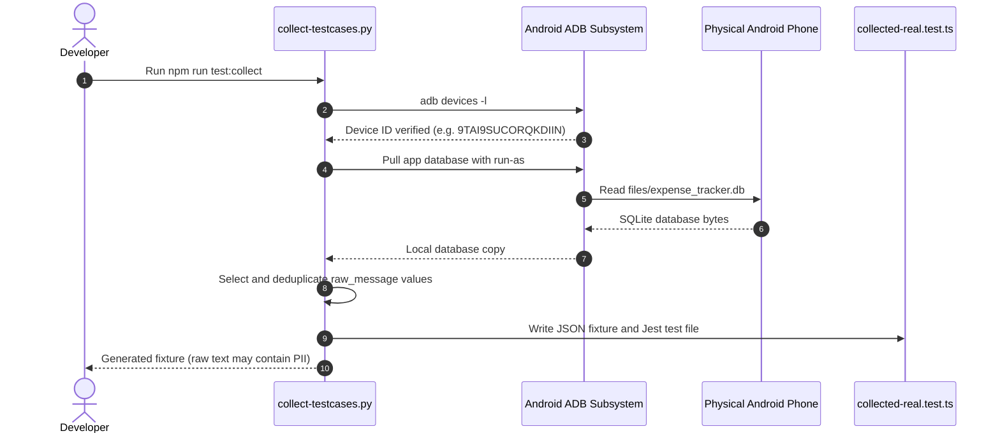

# SpendWise: Quality Assurance & Testing Strategy

## 1. Testing Philosophy & Objectives

SpendWise handles sensitive financial data. Tests and parser diagnostics run locally; optional Jaeger telemetry targets a local collector in development. The device collector copies raw `raw_message` values into a JSON fixture and does **not** redact message text, account identifiers, or other PII. Treat generated fixtures as sensitive and inspect/sanitize them before sharing or committing. The testing strategy follows these tenets:

1. **Local Test Execution & Data Care**: Unit tests, type checks, ESLint, and parser diagnostics run locally. The collector does not anonymize the financial message body or account identifiers.
2. **Deterministic Processing**: Given an identical SMS string, the parsing, deduplication, categorization, and balance calculations must produce identical database mutations regardless of network status or time of day.
3. **Headless Verification**: Parser changes can be exercised with the local diagnostic CLI; runtime depends on machine and dataset, so no fixed duration is promised.
4. **Hardware Samples**: Device-derived samples can supplement synthetic parser tests, subject to consent and careful handling of raw financial data.

---

## 2. Test Pyramid & Architecture

```
                    ┌─────────────────────────┐
                    │   Physical Device QA    │
                    │  (ADB / Real Hardware)  │
                    ├─────────────────────────┤
                    │   Integration & Tracing │
                    │ (Use cases / adapters) │
                    ├─────────────────────────┤
                    │    Core Unit Tests      │
                    │ (Parser, policy, DB)   │
                    └─────────────────────────┘
```

| Layer | Scope & Purpose | Execution Mode | Tooling |
| :--- | :--- | :--- | :--- |
| **Unit and service tests** | Parser stages, classifier/settings ports, transaction policies/use cases, and stores. | Run locally; measure as needed | Jest, TypeScript |
| **Persistence tests** | SQLite repository behavior and migration scenarios using repository test doubles/fixtures. | Run locally; measure as needed | Jest, Quick-SQLite test doubles |
| **Device samples** | Optional real-device fixtures generated by the ADB collector. Raw message text may contain PII. | Requires connected, authorized Android device for collection | Python 3, ADB, Jest |
| **CLI diagnostics** | Parse a sample message and print parsed fields or throughput output. | Run locally; measure as needed | Node.js, `scripts/parse-sms.sh` |

---

## 3. Core Test Suites Inventory

Test counts and coverage evolve; run the current Jest suite to establish the result for a checkout. The inventory below describes areas covered, not an exhaustive assertion-level guarantee.

### 3.1. Modular Parsing Engine Suites (`src/__tests__/parser/`)
* **`src/__tests__/parser/normalizer.test.ts`**:
  - Tests Unicode mathematical sans-serif/bold glyph conversion (`𝖡𝖮𝖡` ➔ `BOB`, `₹ 𝟓𝟒𝟗` ➔ `₹ 549`).
  - Tests currency standardizer converting `Rs.`, `₹`, `INR`, `INR.` to uniform `INR` with boundary markers.
  - Tests keyword normalizer (`a/c` ➔ `account`, `txn` ➔ `transaction`, `ref no` ➔ `reference`, `bal` ➔ `balance`).
  - Tests whitespace normalizer collapsing multi-space, tab, and newline irregularities.

* **`src/__tests__/parser/tokenizer.test.ts`**:
  - Validates lexical token categorization: `AMOUNT`, `ACCOUNT`, `VPA`, `KEYWORD`, `DATE`, `REF_NUMBER`, `MERCHANT_HINT`, `WORD`, `SEPARATOR`, `UNKNOWN`.
  - Verifies exact start and end offset index preservation across the token stream.

* **`src/__tests__/parser/extractor.test.ts`**:
  - Tests targeted `AmountExtractor` against decimal figures, comma separation, and balance collision prevention.
  - Tests `AccountExtractor` against masked accounts: `XX1234`, `*5678`, `Card ending in 9012`.
  - Tests `BankExtractor` against configured DLT headers and body mentions; this is not a complete guarantee of provider coverage.
  - Tests `VpaExtractor` validating UPI handles (`name@bank`) and stripping bank extensions.
  - Tests `ReferenceExtractor` capturing 12-digit UPI RRN / bank reference numbers.
  - Tests `BalanceExtractor` extracting post-transaction account running balances.
  - Tests `PaymentModeExtractor` classifying `upi`, `cc`, `dc`, `netbanking`, `atm`, `cash`.
  - Tests `RawMerchantExtractor` capturing payee strings after `at`, `to`, `spent on`.

* **`src/__tests__/parser/resolvers.test.ts`**:
  - Tests `MerchantResolver`: noise removal, UPI VPA extraction, canonical alias matching (`ZOMATO LTD` ➔ `Zomato`), bank header cleaning.
  - Tests `TransactionResolver`: directionality resolution; prioritizes user debited account in dual debit/credit SMS alerts.
  - Tests `CategoryResolver`: keyword-to-category mapping across 8 core expense categories.

* **`src/__tests__/parser/confidence.test.ts`**:
  - Evaluates parser confidence/confirmation behavior. The final reject/review/auto-save thresholds are separately owned by `src/core/transactions/decisionPolicy.ts`.

* **`src/__tests__/parser/learning.test.ts`**:
  - Tests `LearningEngine` with `InMemoryLearningRepository`.
  - Validates recording of user corrections, merchant-to-category associations, frequency increments, and pattern recalls.

* **`src/__tests__/parser/ai.test.ts`**:
  - Tests conditional invocation and injected-handler behavior for `AIResolver`.
  - Tests the bounded in-memory `AICache`; no persistent AI cache or production inference handler is configured.

* **`src/__tests__/parser/filter.test.ts`**:
  - Verifies rejection of non-financial SMS, OTP verification alerts, cellular recharge alerts, and personal messages.

* **`src/__tests__/parser/orchestrator.test.ts`**:
  - Verifies complete 10-stage execution pipeline producing strongly typed `StructuredExpense` instances.

### 3.2. Legacy Backward Compatibility & Golden Regression Suites
* **`src/__tests__/parser.test.ts`**:
  - Regression coverage for the legacy `parseMessage(message, sender, source)` adapter.
  - Tests complex bank formats across SBI, HDFC, ICICI, Axis, Kotak, BOB, PNB, and UPI apps.

* **`src/__tests__/collected-real.test.ts`**:
  - Optional device-derived regression fixtures; sample count depends on the checked-in fixture.
  - Provides examples, not a guarantee of coverage for all banks or future message formats.

### 3.3. Deduplication, Repository & State Integrity Suites
* **`src/__tests__/dedup.test.ts`**:
  - Validates reference-ID and normalized exact-message deduplication.
  - Validates UPI Reference ID deduplication: preventing duplicate records when both bank SMS and merchant SMS are received for the same payment.
  - Tests amount/merchant/time possible matches in the current five-minute deduplication window.
  - Tests split auto-repayment reconciliation: recognizing when a friend repays an outstanding split debt via UPI.

* **`src/__tests__/filter.test.ts`**:
  - Evaluates TRAI DLT alphanumeric sender validation (e.g., `VM-HDFCBK`, `AD-SBIINB`, `BP-KOTAKB`, `JX-BOBSMS`).
  - Verifies rejection of personal 10-digit mobile phone senders (`+919876543210`).

* **`src/__tests__/classifier.test.ts` & `bayesClassifier.test.ts`**:
  - Tests on-device Bayesian spam probability scoring against edge-case marketing messages that mention currency figures.

* **`src/__tests__/databaseMigrations.test.ts`**:
  - Tests fresh and supported legacy schemas, additive upgrades, transaction rollback/retry, and refusal of unsupported/future schemas. The current migration sequence ends at version 2.

* **`src/__tests__/advisorService.test.ts`**:
  - Validates monthly burn-rate calculations and predictive budget exhaustion warnings.

* **`src/__tests__/retryQueue.test.ts`**:
  - Validates transient failure handling with exponential backoff retry mechanisms.

* **`src/__tests__/transactionOrchestrator.test.ts`**:
  - Verifies transaction orchestration and decision outcomes. Persistence and deduplication are executed by the transaction application layer, not by the parser orchestrator itself.

---

## 4. Hardware-in-the-Loop Device Test Harness

To eliminate the disconnect between synthetic mock data and real-world bank SMS templates, SpendWise includes an automated physical device test harness.

### 4.1. The Device Harvester (`scripts/collect-testcases.py`)
Connect an Android device via USB debugging and execute:
```bash
npm run test:collect
# or: python3 scripts/collect-testcases.py
```



### 4.2. Sensitive fixture handling

The current script does not sanitize message text, phone numbers, names, account identifiers, or VPAs. The generated fixture can expose financial and personal information. Do not share or commit it until it has been reviewed and manually sanitized; remove local copies when no longer needed.

---

## 5. Headless CLI Diagnostics

Developers can inspect a sample SMS without building an APK by using the local CLI diagnostic runner:

### 5.1. Running the CLI Runner
```bash
npm run parse -- --sender "HDFCBK" --msg "Dear Customer, your A/c XX1234 is debited for Rs 450.00 on 18-Oct-26 at SWIGGY - HDFC Bank"
```

### 5.2. Sample Diagnostic Output
```
============================================================
🔍 BACKEND PIPELINE DIAGNOSTIC REPORT
============================================================
📨 Sender:            HDFCBK
💬 Message:           "Dear Customer, your A/c XX1234 is debited for Rs 450.00 on 18-Oct-26 at SWIGGY - HDFC Bank"
------------------------------------------------------------
1. Transaction Sender:    ✅ YES
2. Passed Content Filter:  ✅ YES
3. Spam Classifier:       ✅ NOT SPAM (Score: 0.002)
4. Detected Bank:         HDFC Bank
------------------------------------------------------------
📊 PARSED EXTRACTED DATA:
   • Amount:              ₹450.00
   • Transaction Type:    DEBIT
   • Payment Mode:        UPI
   • Merchant / Payee:    SWIGGY
   • Account Number:      XX1234
   • Available Balance:   ₹12,450.20
   • Reference ID:        REF9201948102
============================================================
```

---

## 6. Observability & Tracing Verification (`diagnose.test.ts`)

SpendWise integrates OpenTelemetry distributed tracing to monitor pipeline bottlenecks:

1. **Start Jaeger Standalone Daemon**:
   ```bash
   npm run jaeger:start
   ```
2. **Execute Diagnostic Tracing Test**:
   ```bash
   npm test src/__tests__/diagnose.test.ts
   ```
3. **Verify in Jaeger Web UI**:
   Navigate to `http://localhost:16686` to inspect:
   - Message analysis span: `sms.process_pipeline` with source, sender, parsed fields, and rejection attributes.
   - Selected repository functions emit `db.*` spans through the telemetry adapter.
   - The adapter runs only in development outside tests. Its sender attribute is not phone-number-redacted.

---

## 7. Edge Case & Failure Mode Matrix

| Scenario / Edge Case | Expected System Behavior | Test Coverage File |
| :--- | :--- | :--- |
| **Mathematical Bold Unicode Fonts** (e.g., `₹ 𝟓𝟒𝟗 𝐝𝐞𝐛𝐢𝐭𝐞𝐝`) | Automatically normalized to standard ASCII characters before regex parsing. | `parser.test.ts` |
| **Dual Debit & Credit in Same Message** ("Rs. 100 Dr from A/C 1234 and Cr to X") | Prioritize the user's primary account debited and extract payee VPA. | `collected-real.test.ts` |
| **Simultaneous Bank & App Notifications** | Deduplication uses reference IDs, exact normalized message matching, and amount/merchant/time possible-match checks in a five-minute window. | `dedup.test.ts` |
| **Reversals / Failed Payments** | Detect keywords `reversed`, `failed`, `refunded` and flag transaction as reversed without skewing monthly spend. | `parser.test.ts` |
| **Device Running Low Storage** | Catch SQLite disk-full exceptions, queue transactions in in-memory buffer, and alert user gracefully. | `retryQueue.test.ts` |
| **User Manual Cash Modification** | Allow manual editing of category, amount, and notes; preserve original raw SMS in database unchanged. | `expenseRepo.test.ts` |

---

## 8. Release Acceptance Checklist

Prior to tagging any production release (`git tag vX.Y.Z`), the following verification criteria must be met:

- [ ] **TypeScript Check**: `npx tsc --noEmit` completes with 0 errors.
- [ ] **Jest Suite**: Full Jest suite passes for the release candidate; record the command and outcome in release evidence.
- [ ] **Lint Cleanliness**: `npm run lint` passes with 0 fatal errors.
- [ ] **Hardware Sanity**: When device-derived samples are needed, collect only with authorization and inspect/sanitize the generated raw-message fixture before sharing or committing it.
- [ ] **Database Migration Integrity**: Migration tests cover supported legacy fixtures through the latest schema version (currently version 2); validate representative on-device backups before release.
- [ ] **Release APK Build**: Android release variant builds successfully with `cd android && ./gradlew :app:assembleRelease`.

---

## 9. Automated Pre-Commit Verification Gate

To prevent broken code or failing tests from entering version control, SpendWise implements an automated pre-commit hook:

* **Location**: [`.githooks/pre-commit`](../.githooks/pre-commit)
* **Configuration**: `git config core.hooksPath .githooks` (version-controlled Git hooks)
* **Execution Flow**:
  1. Triggered on commit only when Git is configured with `core.hooksPath .githooks`.
  2. Runs `npm test` and aborts the commit on test failure.
  3. It does not run TypeScript or lint; run those checks separately.

## 10. Current verification commands

```bash
npm test -- --runInBand
npx tsc --noEmit
npm run lint
npm run parse -- --help
npm run benchmark
```

`npm run lint` runs the static import-boundary check followed by ESLint. Hardware collection uses `npm run test:collect`; inspect the generated fixture before sharing or committing it.


