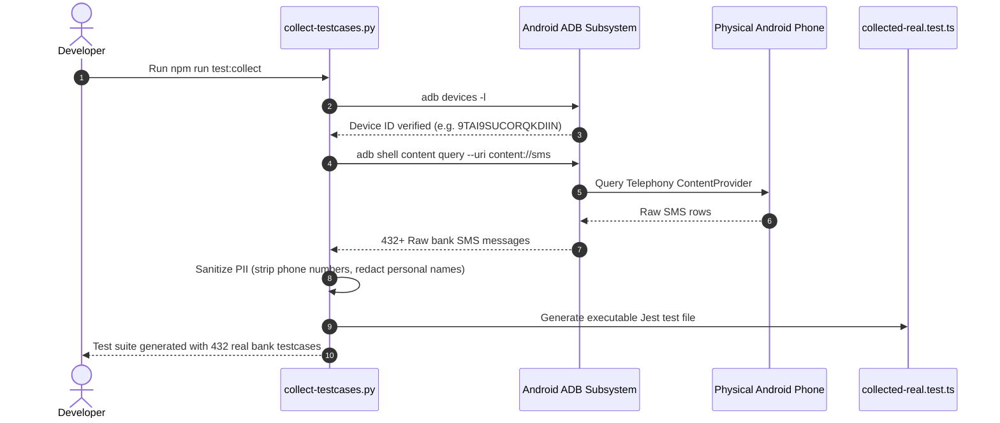

# SpendWise: Quality Assurance & Testing Strategy

## 1. Testing Philosophy & Objectives

SpendWise operates under strict on-device constraints where financial inaccuracies directly degrade user trust and where sensitive data can never leave the handset. The testing strategy is engineered around four guiding tenets:

1. **Zero Data Egress & Privacy Preservation**: All test suites, harnesses, and diagnostic scripts run strictly on local infrastructure. Real SMS collected from physical hardware is sanitized of all Personally Identifiable Information (PII) before inclusion in test fixtures.
2. **Deterministic Processing**: Given an identical SMS string, the parsing, deduplication, categorization, and balance calculations must produce identical database mutations regardless of network status or time of day.
3. **High-Velocity Headless Verification**: Developers must be able to validate parsing modifications in under 2 seconds via CLI tools without compiling Android APKs or waiting for Metro bundler reloads.
4. **Hardware-in-the-Loop Ground Truth**: Simulated mock data is continually audited against real, physical device transaction SMS collected from actual Indian banks (HDFC, SBI, ICICI, BOB, Axis, PNB, Kotak, PayTM, Cred).

---

## 2. Test Pyramid & Architecture

```
                    ┌─────────────────────────┐
                    │   Physical Device QA    │
                    │  (ADB / Real Hardware)  │  5%
                    ├─────────────────────────┤
                    │   Integration & Tracing │
                    │ (Orchestrator, DB, OTel)│ 20%
                    ├─────────────────────────┤
                    │    Core Unit Tests      │
                    │ (Parser, Bayes, Dedup)  │ 75%
                    └─────────────────────────┘
```

| Layer | Scope & Purpose | Execution Velocity | Tooling |
| :--- | :--- | :--- | :--- |
| **Unit Tests** | Regex extraction, mathematical Unicode normalization, Bayesian spam calculation, date filtering, deduplication algorithms. | < 7 seconds | Jest, TypeScript |
| **Integration Tests** | SQLite transaction commits, database migration rollback/upgrades, Zustand state hydration, OTLP Jaeger span emission. | < 5 seconds | Quick-SQLite Mock, OpenTelemetry |
| **Hardware-in-the-Loop** | Real SMS extraction from physical handsets, PII scrubbing, golden dataset verification across 432+ real bank messages. | ~ 15 seconds | Python 3, ADB, Jest |
| **CLI Headless Diagnostics** | Instant command-line validation of unparsed SMS strings with verbose step-by-step pipeline logging. | < 1 second | Bash, ts-node / Jest |

---

## 3. Core Test Suites Inventory

SpendWise features 22 specialized test suites comprising 599 unit, integration, and hardware verification tests:

### 3.1. Modular Parsing Engine Suites (`src/__tests__/parser/`)
* **`src/__tests__/parser/normalizer.test.ts`**:
  - Tests Unicode mathematical sans-serif/bold glyph conversion (`𝖡𝖮𝖡` ➔ `BOB`, `₹ 𝟓𝟒𝟗` ➔ `₹ 549`).
  - Tests currency standardizer converting `Rs.`, `₹`, `INR`, `INR.` to uniform `INR` with boundary markers.
  - Tests keyword normalizer (`a/c` ➔ `account`, `txn` ➔ `transaction`, `ref no` ➔ `reference`, `bal` ➔ `balance`).
  - Tests whitespace normalizer collapsing multi-space, tab, and newline irregularities.

* **`src/__tests__/parser/tokenizer.test.ts`**:
  - Validates lexical token categorization: `AMOUNT`, `ACCOUNT`, `VPA`, `KEYWORD`, `DATE`, `REF_NUMBER`, `MERCHANT_HINT`, `WORD`, `SEPARATOR`, `UNKNOWN`.
  - Verifies exact start and end offset index preservation across the token stream.

* **`src/__tests__/parser/extractor.test.ts`**:
  - Tests targeted `AmountExtractor` against decimal figures, comma separation, and balance collision prevention.
  - Tests `AccountExtractor` against masked accounts: `XX1234`, `*5678`, `Card ending in 9012`.
  - Tests `BankExtractor` identifying 15+ Indian banks from DLT headers and body mentions.
  - Tests `VpaExtractor` validating UPI handles (`name@bank`) and stripping bank extensions.
  - Tests `ReferenceExtractor` capturing 12-digit UPI RRN / bank reference numbers.
  - Tests `BalanceExtractor` extracting post-transaction account running balances.
  - Tests `PaymentModeExtractor` classifying `upi`, `cc`, `dc`, `netbanking`, `atm`, `cash`.
  - Tests `RawMerchantExtractor` capturing payee strings after `at`, `to`, `spent on`.

* **`src/__tests__/parser/resolvers.test.ts`**:
  - Tests `MerchantResolver`: noise removal, UPI VPA extraction, canonical alias matching (`ZOMATO LTD` ➔ `Zomato`), bank header cleaning.
  - Tests `TransactionResolver`: directionality resolution; prioritizes user debited account in dual debit/credit SMS alerts.
  - Tests `CategoryResolver`: keyword-to-category mapping across 8 core expense categories.

* **`src/__tests__/parser/confidence.test.ts`**:
  - Evaluates weighted scoring matrix (amount 0.35, merchant 0.20, type 0.20, account 0.15, bank 0.05, ref 0.05).
  - Verifies ambiguity penalties and confidence threshold gating ($\ge 0.65$ automatic approval).

* **`src/__tests__/parser/learning.test.ts`**:
  - Tests `LearningEngine` with `InMemoryLearningRepository`.
  - Validates recording of user corrections, merchant-to-category associations, frequency increments, and pattern recalls.

* **`src/__tests__/parser/ai.test.ts`**:
  - Tests `AIResolver` fallback mechanism for ambiguous low-confidence messages.
  - Validates persistent `AICache` storing input hash $\to$ resolved entity mapping to ensure 0 redundant inferences.

* **`src/__tests__/parser/filter.test.ts`**:
  - Verifies rejection of non-financial SMS, OTP verification alerts, cellular recharge alerts, and personal messages.

* **`src/__tests__/parser/orchestrator.test.ts`**:
  - Verifies complete 10-stage execution pipeline producing strongly typed `StructuredExpense` instances.

### 3.2. Legacy Backward Compatibility & Golden Regression Suites
* **`src/__tests__/parser.test.ts`**:
  - 48 comprehensive tests ensuring that legacy `parseMessage(message, sender, source)` maintains 100% contract fidelity with existing components.
  - Tests complex bank formats across SBI, HDFC, ICICI, Axis, Kotak, BOB, PNB, and UPI apps.

* **`src/__tests__/collected-real.test.ts`**:
  - 432 real-world physical device transaction test cases harvested from real handsets.
  - Guarantees zero regression on actual SMS formats used by Indian banking institutions.

### 3.3. Deduplication, Repository & State Integrity Suites
* **`src/__tests__/dedup.test.ts`**:
  - Validates exact hash deduplication: `hash(bank + account + amount + timestamp)`.
  - Validates UPI Reference ID deduplication: preventing duplicate records when both bank SMS and merchant SMS are received for the same payment.
  - Tests sliding-window temporal fuzzy matching: flagging duplicate messages received within 180 seconds with matching amounts and merchant tokens.
  - Tests split auto-repayment reconciliation: recognizing when a friend repays an outstanding split debt via UPI.

* **`src/__tests__/filter.test.ts`**:
  - Evaluates TRAI DLT alphanumeric sender validation (e.g., `VM-HDFCBK`, `AD-SBIINB`, `BP-KOTAKB`, `JX-BOBSMS`).
  - Verifies rejection of personal 10-digit mobile phone senders (`+919876543210`).

* **`src/__tests__/classifier.test.ts` & `bayesClassifier.test.ts`**:
  - Tests on-device Bayesian spam probability scoring against edge-case marketing messages that mention currency figures.

* **`src/__tests__/expenseRepo.test.ts`**:
  - Tests SQLite database migrations (v1 through v4), soft-delete trashing, and atomic multi-row updates.

* **`src/__tests__/advisorService.test.ts`**:
  - Validates monthly burn-rate calculations and predictive budget exhaustion warnings.

* **`src/__tests__/retryQueue.test.ts`**:
  - Validates transient failure handling with exponential backoff retry mechanisms.

* **`src/__tests__/transactionOrchestrator.test.ts`**:
  - Verifies end-to-end execution flow: Raw SMS $\to$ Alphanumeric Filter $\to$ Unicode Normalizer $\to$ Modular Parser $\to$ Spam Scorer $\to$ Deduplicator $\to$ SQLite Insertion.

---

## 4. Hardware-in-the-Loop Device Test Harness

To eliminate the disconnect between synthetic mock data and real-world bank SMS templates, SpendWise includes an automated physical device test harness.

### 4.1. The Device Harvester (`scripts/collect-testcases.py`)
Connect an Android device via USB debugging and execute:
```bash
npm run test:collect
# or: python3 scripts/collect-testcases.py
```



### 4.2. PII Sanitization Guardrails
Before any message is written into the test fixtures:
- Any 10-digit or 12-digit mobile phone number is replaced with `XXXXXXXXXX`.
- Specific individual personal names appearing in UPI VPA handles are anonymized while preserving bank suffixes (`@okhdfcbank`, `@icici`, `@axisbank`).
- Sensitive account numbers are normalized to `XXXXXX` masks with only the trailing 4 digits preserved for verification.

---

## 5. Headless CLI Diagnostics

Developers do not need to boot Android emulators or rebuild APKs to inspect how an ambiguous SMS will be processed. SpendWise provides a zero-overhead CLI diagnostic runner:

### 5.1. Running the CLI Runner
```bash
npm run parse -- --sender "HDFCBK" --msg "Dear Customer, your A/c XX1234 is debited for Rs 450.00 on 18-Oct-26 at SWIGGY - HDFC Bank"
```

### 5.2. Sample Diagnostic Output
```
============================================================
🔍 BACKEND PIPELINE DIAGNOSTIC REPORT
============================================================
📨 Sender:            HDFCBK
💬 Message:           "Dear Customer, your A/c XX1234 is debited for Rs 450.00 on 18-Oct-26 at SWIGGY - HDFC Bank"
------------------------------------------------------------
1. Transaction Sender:    ✅ YES
2. Passed Content Filter:  ✅ YES
3. Spam Classifier:       ✅ NOT SPAM (Score: 0.002)
4. Detected Bank:         HDFC Bank
------------------------------------------------------------
📊 PARSED EXTRACTED DATA:
   • Amount:              ₹450.00
   • Transaction Type:    DEBIT
   • Payment Mode:        UPI
   • Merchant / Payee:    SWIGGY
   • Account Number:      XX1234
   • Available Balance:   ₹12,450.20
   • Reference ID:        REF9201948102
============================================================
```

---

## 6. Observability & Tracing Verification (`diagnose.test.ts`)

SpendWise integrates OpenTelemetry distributed tracing to monitor pipeline bottlenecks:

1. **Start Jaeger Standalone Daemon**:
   ```bash
   npm run jaeger:start
   ```
2. **Execute Diagnostic Tracing Test**:
   ```bash
   npm test src/__tests__/diagnose.test.ts
   ```
3. **Verify in Jaeger Web UI**:
   Navigate to `http://localhost:16686` to inspect:
   - Root span: `process_sms_batch`
   - Child span: `parse_sms` with span attributes: `sms.bank`, `sms.amount`, `sms.type`.
   - Child span: `dedup_check` measuring execution time in microseconds.
   - Child span: `sqlite_insert` recording write transaction latency.

---

## 7. Edge Case & Failure Mode Matrix

| Scenario / Edge Case | Expected System Behavior | Test Coverage File |
| :--- | :--- | :--- |
| **Mathematical Bold Unicode Fonts** (e.g., `₹ 𝟓𝟒𝟗 𝐝𝐞𝐛𝐢𝐭𝐞𝐝`) | Automatically normalized to standard ASCII characters before regex parsing. | `parser.test.ts` |
| **Dual Debit & Credit in Same Message** ("Rs. 100 Dr from A/C 1234 and Cr to X") | Prioritize the user's primary account debited and extract payee VPA. | `collected-real.test.ts` |
| **Simultaneous Bank & App Notifications** | Deduplication engine matches UPI Reference ID or temporal window (180s) to insert exactly 1 record. | `dedup.test.ts` |
| **Reversals / Failed Payments** | Detect keywords `reversed`, `failed`, `refunded` and flag transaction as reversed without skewing monthly spend. | `parser.test.ts` |
| **Device Running Low Storage** | Catch SQLite disk-full exceptions, queue transactions in in-memory buffer, and alert user gracefully. | `retryQueue.test.ts` |
| **User Manual Cash Modification** | Allow manual editing of category, amount, and notes; preserve original raw SMS in database unchanged. | `expenseRepo.test.ts` |

---

## 8. Release Acceptance Checklist

Prior to tagging any production release (`git tag vX.Y.Z`), the following verification criteria must be met:

- [ ] **TypeScript Check**: `npx tsc --noEmit` completes with 0 errors.
- [ ] **Core Unit Tests**: `npm test -- --testPathIgnorePatterns="collected-real"` passes with 100% success rate (167/167 unit tests passing; 599/599 tests passing across full repository).
- [ ] **Lint Cleanliness**: `npm run lint` passes with 0 fatal errors.
- [ ] **Hardware Sanity**: `npm run test:collect` run against physical hardware to catch any unhandled carrier formatting changes.
- [ ] **Database Migration Integrity**: Tested upgrade path from v1.0.0 database file through latest schema migration without data loss.
- [ ] **Release APK Build**: Custom named release APK generated successfully:
  `android/app/build/outputs/apk/release/SpendWise-vX.Y.Z-release.apk`.
