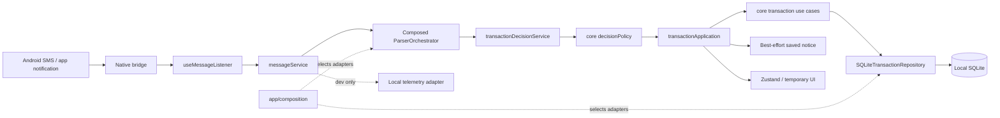

# 🛠️ Technical Requirements Document (TRD)

# 📱 Smart Expense Tracker (SpendWise)

| Metadata                      | Details                                                            |
| :---------------------------- | :----------------------------------------------------------------- |
| **System Name**         | Smart Expense Tracker Technical Architecture                       |
| **Document Version**    | 2.0 (current runtime contracts)                                    |
| **Language & Runtimes** | TypeScript 5.8, Kotlin, C++20, Node.js 22+                         |
| **Frameworks**          | React Native 0.85.3 (New Architecture / Bridgeless), Hermes Engine |
| **Database**            | Embedded SQLite 3 via `react-native-quick-sqlite` (JSI bindings) |
| **Observability**       | OpenTelemetry OTLP (HTTP/JSON) + Local Jaeger v1.60                |
| **Last Updated**        | October 2026                                                       |

---

## 1. System Architecture Overview

This document describes current runtime contracts. Detailed Android API/version claims should be checked against the native source before relying on them for a release.

The current system is organized around these responsibilities:

1. **Native input**: Android SMS and supported app notifications reach JavaScript through the `MessageModule`; queued startup messages and live events are consumed by `useMessageListener`.
2. **Application capabilities**: `messageService` collects parser/spam/filter evidence, `transactionDecisionService` calls the single decision policy, and `transactionApplication` coordinates shared write/query use cases.
3. **Core policies and models**: `src/core/` contains parsing, transaction decision, deduplication, repayment, and repository contracts without SQLite or React Native dependencies.
4. **Adapters and persistence**: `src/app/composition/` selects configured services and adapters. SQLite transactions are implemented in `src/database/SQLiteTransactionRepository.ts`; SQLite settings, learning, and classifier-state adapters are under `src/infrastructure/persistence/sqlite/`.
5. **Temporary presentation state**: hooks and legacy screens use Zustand and capability services. Current screens still import some singleton instances from app composition; this is recorded in the [UI replacement issue list](./UI_REPLACEMENT_ISSUES.md) for later work.

Local AI inference is not configured. Optional telemetry is enabled only in `__DEV__` outside tests and targets a local Jaeger endpoint. The current telemetry call includes a sender attribute; it truncates long strings but does not redact phone numbers.



---

## 2. Technology Stack & Decision Rationale

| Layer                      | Selected Technology           | Alternative Considered      | Technical Rationale                                                                                                                                                 |
| :------------------------- | :---------------------------- | :-------------------------- | :------------------------------------------------------------------------------------------------------------------------------------------------------------------ |
| **Mobile Runtime**   | React Native 0.85 + Hermes    | Flutter / Native Kotlin UI  | Enables cross-platform TypeScript business logic with instant hot reloading, while running on the New Architecture with Bridgeless Hermes execution.                |
| **Database**         | `react-native-quick-sqlite` | WatermelonDB / AsyncStorage | Direct C++ JSI binding directly into SQLite. Executes synchronous SQL statements without the JSON serialization overhead of standard React Native bridge modules.   |
| **State Management** | Zustand 5.0                   | Redux Toolkit / MobX        | Ultra-lightweight footprint (~1.2kB), zero boilerplate, outside-React imperative access (crucial for background receivers), and high-frequency selective rendering. |
| **Native Bridge**    | TurboModules JSI              | Old React Native Bridge     | Direct memory access between C++/Kotlin and Hermes JS engine without asynchronous JSON string queues.                                                               |
| **Local Tracing**    | OpenTelemetry + Jaeger        | Firebase Performance        | Optional development traces target a local Jaeger collector on port `4318`; no remote analytics service is configured.                          |

---

## 3. Native Android Subsystem Specifications

### 3.1 Android Manifest Configuration (`AndroidManifest.xml`)

The native subsystem requires specific permissions declared in `android/app/src/main/AndroidManifest.xml`:

```xml
<!-- SMS Interception -->
<uses-permission android:name="android.permission.RECEIVE_SMS" />
<uses-permission android:name="android.permission.READ_SMS" />

<!-- Contacts for Split Ledger -->
<uses-permission android:name="android.permission.READ_CONTACTS" />

<!-- System Alert for Floating Low-Confidence Dialogs -->
<uses-permission android:name="android.permission.SYSTEM_ALERT_WINDOW" />
```

### 3.2 Native Broadcast Receiver (`SmsReceiver.kt`)

* **Trigger**: Listens for `android.provider.Telephony.SMS_RECEIVED` action with high priority (`android:priority="999"`).
* **Execution**:
  1. Reconstructs multipart SMS messages using `Telephony.Sms.Intents.getMessagesFromIntent(intent)`.
  2. Extracts originating address (`sender`) and body.
  3. Pre-filters non-transactional senders (e.g., standard 10-digit phone numbers starting with `+91` or `[6-9]`).
  4. Emits `onSMSReceived` event via React Native DeviceEventEmitter.

### 3.3 Notification Listener Service (`NotificationListener.kt`)

* **Trigger**: Extends Android `NotificationListenerService` bound to `android.service.notification.NotificationListenerService`.
* **Target Packages**: Intercepts notifications strictly from financial package identifiers:
  * `com.google.android.apps.nbu.paisa.user` (Google Pay)
  * `com.phonepe.app` (PhonePe)
  * `net.one97.paytm` (Paytm)
  * `in.org.npci.upiapp` (BHIM)
  * `com.dreamplug.androidapp` (Cred)
* **Payload**: Extracts notification title, body, subText, and timestamp; dispatches `onNotificationReceived` to JS.

### 3.4 Historical Paged SMS Querying (`MessageModule.kt`)

Exposes paged querying against `content://sms/inbox`:

* **`fetchPastMessagesSince(startTimestamp, pageSize, afterTimestamp)`**:
  * Implements cursor-based indexing ordered by `date ASC LIMIT ?`.
  * Filters non-alphabetic senders using regex `.*[a-zA-Z].* || ^\d{3,9}$`.
  * Resolves as a serialized JSON array without exceeding Android Binder IPC buffer limits (1MB).

### 3.5 Native Biometric & Keyguard Security Module (`SecurityModule.kt`)

* **Integration**: `androidx.biometric:biometric:1.1.0`.
* **Lifecycle & Concurrency Safety**:
  * Implements `LifecycleEventListener`: automatically cancels any active `BiometricPrompt` on `onHostPause()` and `onHostDestroy()` to prevent `IllegalStateException` crashes across activity lifecycle events.
  * Mutex protection via `isAuthenticating = AtomicBoolean(false)`: prevents duplicate concurrent `BiometricPrompt` launches.
* **Authenticators**: Version-adaptive authentication:
  * API 30+ (Android 11+): `setAllowedAuthenticators(BIOMETRIC_STRONG or DEVICE_CREDENTIAL)`.
  * API 24–29 (Android 7–10): `setDeviceCredentialAllowed(true)` with KeyguardManager fallback.
* **Window Security (`FLAG_SECURE`) & Privacy Shield**:
  * Enforced on `MainActivity.onCreate` and `MainActivity.onResume` with `window.addFlags(FLAG_SECURE)` to block recent apps task-switcher snapshots and screen captures across OEM launchers.
  * Dynamically toggled via `setSecureFlag(enable: Boolean, promise: Promise)`.
  * `SecurityGate.tsx` completely isolates `{children}` with `display: 'none'`, `pointerEvents="none"`, and `accessibilityElementsHidden={true}` when locked, rendering `<LockScreen />` exclusively with hardware `BackHandler` app-minimizing protection.
* **Methods**:
  * `isDeviceAuthAvailable(promise)`: Queries system `BiometricManager` and `KeyguardManager.isDeviceSecure` safely across all API versions without throwing `IllegalArgumentException`.
  * `authenticate(title, subtitle, promise)`: Launches Android `BiometricPrompt` on the UI thread with FragmentManager lifecycle guards, concurrency locks, and single-settle promise resolution.
  * `cancelAuthentication(promise)`: Cleanly cancels active biometric authentication and cleans up prompt references.
  * `setSecureFlag(enable, promise)`: Sets or clears `WindowManager.LayoutParams.FLAG_SECURE` on the host Activity window.

---

## 4. Modular Parsing Engine Specifications (`src/core/parser/`)

The parsing engine replaces brittle regex monoliths with a decoupled, clean-architecture 10-stage pipeline:

```
Raw Message & Sender
       │
       ▼
[1. Message Filter] ────────► Drop OTP / Telecom / Non-Financial Promos
       │
       ▼
[2. Composable Normalizers] ─► Unicode ➔ Currency ➔ Keyword ➔ Whitespace
       │
       ▼
[3. Lexical Tokenizer] ─────► Classifies Token Stream with Span Offsets
       │
       ▼
[4. Targeted Extractors] ───► Amount, Account, Bank, VPA, Ref, Balance, Mode
       │
       ▼
[5. Dynamic Bank Rules] ────► Declarative rules from bankRules.json
       │
       ▼
[6. Contextual Resolvers] ──► Merchant Aliases, Transaction Direction, Category
       │
       ▼
[7. Confidence Engine] ─────► Mathematical Multi-Factor Quality Score
       │
       ▼
[8. Learning Engine] ───────► Correction lookup through ILearningRepository
       │
       ▼
[9. Optional AI Resolver] ──► Only if enabled and a handler is injected
       │
       ▼
[10. StructuredExpense] ────► Strongly Typed Immutable Financial Record
```

### 4.1 Composable Normalization Pipeline (`src/core/parser/normalizer/`)

The normalizer executes sequentially across four modular transformations:

1. **`unicodeNormalizer`**:
   - Maps mathematical bold, sans-serif, and styled glyphs (`0x1D400`–`0x1D7FF`) back to standard ASCII alphanumerics (`A-Z`, `a-z`, `0-9`).
   - Strips zero-width joiners, soft hyphens, and directional formatting marks.
2. **`currencyNormalizer`**:
   - Normalizes common rupee spellings (`Rs.`, `Rs`, `INR`) to the rupee symbol (`₹`) with clean spacing.
3. **`keywordNormalizer`**:
   - Standardizes common abbreviations across Indian banking SMS (`a/c` / `acct` ➔ `account`, `txn` ➔ `transaction`, `ref no` ➔ `reference`, `bal` / `avl bal` ➔ `balance`).
4. **`whitespaceNormalizer`**:
   - Collapses consecutive whitespace, tabs, and line-breaks into single standard ASCII spaces.

### 4.2 Lexical Tokenizer (`src/core/parser/tokenizer/`)

The tokenizer transforms normalized text into a stream of typed `Token` objects, preserving token value, position, and semantic classification:

```typescript
export interface Token {
  type: TokenType;
  value: string;
  normalizedValue: string;
  startIndex: number;
  endIndex: number;
}

export type TokenType =
  | 'AMOUNT'
  | 'ACCOUNT'
  | 'VPA'
  | 'KEYWORD'
  | 'DATE'
  | 'REF_NUMBER'
  | 'MERCHANT_HINT'
  | 'WORD'
  | 'SEPARATOR'
  | 'UNKNOWN';
```

### 4.3 Data-Driven Declarative Rules (`src/core/parser/config/`)

All bank templates, merchant cleaning patterns, and categories are decoupled into declarative JSON schemas:

* **`bankRules.json`**:
  Defines configured patterns, sender prefixes, and priority overrides for bank and payment formats. A configured rule is not a guarantee of coverage; parser tests and representative messages determine verified support.
* **`merchantAliases.json`**:
  Maintains canonical brand maps and noise-stripping rules:
  - Noise prefixes stripped: `VPA`, `UPI/`, `PAYTM*`, `BILLDESK/`, `POS/`, `NEFT-`, `IMPS-`.
  - Canonical aliases: `ZOMATO LTD` ➔ `Zomato`, `SWIGGY_BLR` ➔ `Swiggy`, `AMZN-MKTPLACE` ➔ `Amazon`, `UBER INDIA` ➔ `Uber`, `FLIPKART-PAY` ➔ `Flipkart`.
* **`categoryRules.json`**:
  Maps canonical merchants and keywords to 8 primary spending buckets: `Food & Dining`, `Groceries`, `Shopping`, `Travel`, `Utilities`, `Health`, `Entertainment`, `Financial Services`.
* **`tokenDictionary.json`**:
  Defines lexical categories for debit/credit keywords, account prefixes, and reference labels. The dictionary supplies terms; `TransactionResolver` interprets those terms with the parsed message evidence to determine transaction direction.

### 4.4 Targeted Entity Extractors (`src/core/parser/extractor/`)

Specialized extractors operate on the token stream and normalized text independently:

| Extractor                          | Primary Responsibility                                                                                                         |
| :--------------------------------- | :----------------------------------------------------------------------------------------------------------------------------- |
| **`AmountExtractor`**      | Extracts financial figures; enforces positive values; validates against date/account collisions; checks post-currency markers. |
| **`AccountExtractor`**     | Identifies masked accounts (`XX1234`, `*5678`, `ending with 9012`, `Card 3456`).                                       |
| **`BankExtractor`**        | Correlates DLT sender headers (`VM-HDFCBK` ➔ `HDFC`) and body mentions against `bankRules.json`.                        |
| **`VpaExtractor`**         | Validates UPI VPA format (`user@bank`), isolating recipient identifiers while stripping trailing bank suffixes.              |
| **`ReferenceExtractor`**   | Extracts 12-digit UPI RRN, UTR, or bank reference numbers for multi-source deduplication.                                      |
| **`BalanceExtractor`**     | Isolates available/running account balance reported after transaction completion.                                              |
| **`PaymentModeExtractor`** | Disambiguates `upi`, `cc` (credit card), `dc` (debit card), `netbanking`, `atm`, `cash`.                           |
| **`RawMerchantExtractor`** | Extracts candidate merchant strings following positional markers (`at`, `to`, `spent on`, `VPA`).                      |

### 4.5 Contextual Business Resolvers (`src/core/parser/resolver/`)

* **`MerchantResolver`**:
  Cleans noisy SMS merchant tokens, removes trailing city tags, handles UPI handle sanitization, matches canonical aliases in `merchantAliases.json`, and verifies against known bank entities.
* **`TransactionResolver`**:
  Determines transaction directionality (`debit` vs `credit`). Resolves dual-action alerts (e.g., *"debited Rs 1.00 and credited to payee@upi"*) by prioritizing the user's debited account.
* **`CategoryResolver`**:
  Combines rule-based category matching, token keywords, and user corrections from `LearningEngine` to assign accurate spending categories.

### 4.6 Multi-Factor Confidence Scoring (`src/core/parser/confidence/`)

Calculates a normalized quality score between `0.0` and `1.0` representing extraction certainty:

$$
\text{Confidence} = \sum_{i} (w_i \times s_i)
$$

| Extracted Field            | Weight ($w_i$) | Validation Criteria ($s_i = 1.0$)                             |
| :------------------------- | :--------------: | :-------------------------------------------------------------- |
| **Amount**           |     `0.35`     | Valid positive decimal extracted adjacent to currency marker.   |
| **Transaction Type** |     `0.25`     | Explicit debit/credit keyword detected without ambiguity.       |
| **Merchant**         |     `0.20`     | Payee entity identified and resolved via alias registry or VPA. |
| **Category**         |     `0.10`     | Category resolver finds a rule or learned mapping.              |
| **Account**          |     `0.10`     | Masked account/card pattern identified.                         |

* **Weighting**: Defaults are read from parser configuration and normalized to sum to 1.0. The current engine computes the weighted factor score; it does not apply the penalties listed in older design notes.
* **Active decision policy**: Classifier confidence below `0.5` rejects; scores from `0.5` to below `0.8` go to review; scores at or above `0.8` can auto-save when parser requirements allow it. Parser confidence below `0.5` rejects and `requiresConfirmation` forces review. AI inference is not currently active.

### 4.7 Adaptive On-Device Learning Engine (`src/core/parser/learning/`)

Stores explicit merchant/category corrections locally through the repository used by parser resolvers:

```typescript
export interface ILearningRepository {
  save(mapping: LearnedMapping): void;
  get(rawMerchant: string): LearnedMapping | null;
  getAll(): LearnedMapping[];
}
```

* When a user edits a merchant or updates an expense category, `LearningEngine` stores the association through `ILearningRepository`.
* Standalone parser construction uses `InMemoryLearningRepository`; app composition selects `SQLiteLearningRepository` for production ingestion. Subsequent resolutions consult learned mappings. Token frequency learning and confidence reinforcement are not implemented.

### 4.8 Offline AI Fallback Resolver (`src/core/parser/ai/`)

* `AIResolver` supports an injected inference handler and an in-memory `AICache`.
* No handler/model is currently configured, and `enableAI` defaults to `false`. Therefore no AI inference runs in production today.
* Selecting and integrating an on-device/offline inference runtime is approved future implementation work; network inference is out of scope.

### 4.9 Backward Compatibility Adapter (`src/core/parser/parseMessage.ts`)

To ensure zero regressions across legacy modules, `parseMessage()` wraps `ParserOrchestrator.parse()` and maps `StructuredExpense` to the legacy `ParsedTransaction` contract:

```typescript
export function parseMessage(
  message: string,
  sender = '',
  source: 'sms' | 'notification' | 'manual' = 'sms'
): ParsedTransaction | null;

export function parseStructured(
  message: string,
  sender = '',
  source: 'sms' | 'notification' | 'manual' = 'sms'
): StructuredExpense | null;

export function parseStructuredAsync(
  message: string,
  sender?: string,
  source?: 'sms' | 'notification' | 'manual'
): Promise<StructuredExpense | null>;
```

---

## 5. Database Architecture & Schema Specifications

### 5.1 Storage Engine

* **Engine**: SQLite 3 compiled with C++ JSI direct execution via `react-native-quick-sqlite`.
* **Database Name**: `expense_tracker.db`
* **Location**: App internal sandboxed storage managed by the native SQLite library; the exact path is platform/runtime-owned.
* **Initialization and migrations**: `src/database/db.ts` runs sequential `PRAGMA user_version` migrations before exposing the connection. Current migration version is 3: version 1 establishes/validates the supported legacy baseline and support tables; version 2 adds query indexes; version 3 adds transaction metadata columns (`tags`, `notes`, `bill_image_uri`, `location`). Each migration and version update run in one transaction. Unsupported legacy table shapes and databases newer than the app's latest version fail without being silently rewritten.

### 5.2 Table Schemas

#### 1. `expenses` Table

Stores all individual transactional records:

```sql
-- Fresh-install baseline in src/database/schema.ts.
-- Existing supported databases are upgraded by src/database/migrations/.
CREATE TABLE IF NOT EXISTS expenses (
  id INTEGER PRIMARY KEY AUTOINCREMENT,
  amount REAL NOT NULL,
  merchant TEXT,
  alias TEXT,
  category TEXT,
  confidence REAL,
  timestamp INTEGER NOT NULL,
  source TEXT NOT NULL,
  raw_message TEXT NOT NULL,
  transaction_type TEXT NOT NULL DEFAULT 'debit',
  account TEXT,
  bank TEXT,
  payment_mode TEXT DEFAULT 'unknown',
  is_duplicate INTEGER DEFAULT 0,
  available_balance REAL,
  splits TEXT,               -- JSON serialized array of split entities
  reference_id TEXT,         -- Bank UTR, UPI reference, or transaction reference ID
  is_invalid INTEGER DEFAULT 0, -- Soft delete flag for trashed items
  trash_reason TEXT,
  tags TEXT,                 -- JSON serialized array of user tags (e.g. ["School", "Work"])
  notes TEXT,                -- Freeform transaction note text
  bill_image_uri TEXT,       -- Local URI path to receipt/bill image
  location TEXT,             -- JSON serialized TransactionLocation (immutable GPS snapshot)
  created_at INTEGER DEFAULT (strftime('%s', 'now'))
);

-- Query indexes are applied by migration 2.
```

#### 2. `merchant_categories` Table

Stores user-trained dynamic merchant mappings:

```sql
CREATE TABLE IF NOT EXISTS merchant_categories (
  merchant TEXT PRIMARY KEY,
  category TEXT NOT NULL,
  display_name TEXT
);
```

#### 3. `settings` Table

Key-value store for user configurations:

```sql
CREATE TABLE IF NOT EXISTS settings (
  key TEXT PRIMARY KEY,
  value TEXT
);
```

The `classifier_state` table persists on-device machine learning and statistical model state, including `tag_learning_model` managed by `SQLiteTagLearningRepository.ts` for dynamic self-learning tag classification across entities, categories, payment channels, and message tokens. `splits` is JSON and includes stable split IDs and exact repayment-allocation links when available. See `src/database/schema.ts` and `src/database/migrations/` for the executable schema; this excerpt is descriptive.

---

## 6. Smart Ledger & Repayment Settlement Algorithm

When an incoming credit is processed, the shared transaction application operation reads the full split-bearing ledger through `TransactionRepository`, applies eligible repayments oldest-first, and writes the credit and split updates atomically. Each allocation stores the target expense ID, split ID, and amount. Manual settlement amounts are kept separate. Older repayment rows without exact allocation links cannot be safely reversed and mutation is blocked pending reconciliation. See `src/core/transactions/repaymentPlanner.ts` and `src/core/transactions/applicationUseCases.ts`.

Split rows preserve original `amount`. Cumulative `paidAmount` remains a compatibility summary; `manualPaidAmount` and `repaymentPaidAmount` separate manual settlements from automatic repayment allocations. Older rows without `paidAmount` are treated as unpaid by default, while legacy `isPaid = true` rows are treated as settled.

---

## 7. OpenTelemetry Observability Specifications

### 7.1 Architecture

The app implements an OpenTelemetry OTLP JSON trace exporter running inside `src/infrastructure/observability/telemetryService.ts`:

* **Receiver**: Local Jaeger v1.60 running on developer workstation (`:4318/v1/traces`).
* **Routing**:
  * Physical Device: Routed to `http://127.0.0.1:4318` via `adb reverse tcp:4318 tcp:4318`.
  * Emulator: Automatically routes via gateway `http://10.0.2.2:4318`.
* The exporter is disabled in tests and outside `__DEV__`. Current spans may include the sender value; values are length-limited but phone numbers are not redacted. Keep the collector local and treat trace data as sensitive.

### 7.2 Trace Schema & Exported Attributes

```json
{
  "resourceSpans": [{
    "resource": {
      "attributes": [
        { "key": "service.name", "value": { "stringValue": "expense-tracker-mobile" } },
        { "key": "os.type", "value": { "stringValue": "android" } }
      ]
    },
    "scopeSpans": [{
      "scope": { "name": "com.expensetracker.telemetry" },
      "spans": [{
        "traceId": "32_hex_chars",
        "spanId": "16_hex_chars",
        "name": "sms.process_pipeline",
        "kind": 1,
        "attributes": [
          { "key": "source", "value": { "stringValue": "sms" } },
          { "key": "sender", "value": { "stringValue": "AD-ICICIB" } },
          { "key": "amount", "value": { "doubleValue": 450.0 } },
          { "key": "bank", "value": { "stringValue": "ICICI" } },
          { "key": "type", "value": { "stringValue": "debit" } },
          { "key": "dropped", "value": { "boolValue": false } }
        ]
      }]
    }]
  }]
}
```

---

## 8. Build, Hardware & Compatibility Matrix

| Parameter                     | Specification                                              |
| :---------------------------- | :--------------------------------------------------------- |
| **Minimum Android SDK** | API 26 (Android 8.0 Oreo)                                  |
| **Target Android SDK**  | API 34 / 35 (Android 14 / 15)                              |
| **Supported ABIs**      | `arm64-v8a` (Physical Phones), `x86_64` (Emulators)    |
| **Java / JDK Version**  | OpenJDK 17                                                 |
| **Gradle Distribution** | Gradle 9.3.1                                               |
| **NDK Version**         | 27.1.12297006                                              |
| **Node.js Environment** | Node.js `>= 22.11.0` (Required for Metro `toReversed`) |
