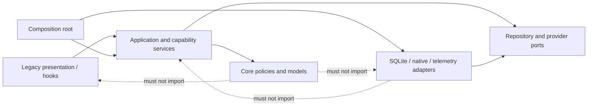

# Phase 8: Domain Organization and Dependency Guardrails

**Status: Complete.** Phase 7 stabilized schema evolution. Phase 8 made module ownership easier to find, removed the observed layer inversions, and added narrow rules to prevent those inversions from returning. The existing UI remains a temporary adapter; no redesign or visual refactor was included.

## Current findings

- `src/core/classifier/spamClassifier.ts` reads and writes settings through `src/database/expenseRepo.ts`, so core classifier behavior depends on SQLite.
- `src/core/parser/learning/LearningEngine.ts` constructs `SQLiteLearningRepository` by default inside the parser package, so parser/core owns concrete storage selection.
- `src/services/securityService.ts` combines security behavior, React Native native-module access, and direct database settings access.
- `src/database/expenseRepo.ts` imports `src/services/telemetryService.ts` to trace repository operations, reversing the intended dependency direction.
- `src/services/transactions/transactionDependencies.ts` is the current composition point for the SQLite transaction repository, but concrete wiring lives under a feature service directory.
- `src/services/transactions/`, `messaging/`, and `notifications/` are already grouped by capability; `advisorService.ts`, `securityService.ts`, and `telemetryService.ts` remain at the services root.
- Legacy screens still call generic settings repository functions directly. Their call sites can be redirected with small adapter changes; screen structure and styling remain out of scope.
- `src/core/parser/` is already a distinct subsystem and should remain focused. `src/types/expense.ts` is a compatibility model shared by storage and legacy presentation, so moving or redesigning it would add churn without a stable replacement contract.

## Target dependency direction

The composition root is the only place that selects concrete adapters. Domain modules remain deterministic and platform-independent. Existing directory names may stay where ownership is already clear; moves should clarify a boundary rather than satisfy a uniform folder pattern.

## Planned work

### 8.1 Remove observed dependency inversions

- Split persisted spam-classifier state from the pure classifier. Keep tokenization, scoring, and state transitions in core; load/save state through a small port implemented by a settings persistence adapter.
- Keep `ILearningRepository` and learning contracts with parser/core, but move `SQLiteLearningRepository` to infrastructure. Construct and inject the persistent learning engine from the composition root; tests can continue using `InMemoryLearningRepository`.
- Make the security capability depend on security-setting and device-auth ports. Keep the existing public operations stable for hooks while moving React Native module access and SQLite-backed settings to adapters.
- Move telemetry implementation out of `services/` into an infrastructure/observability location, or inject an instrumentation port at the outer boundary. Keep repository SQL code independent of application services.
- Move transaction repository construction from `services/transactions/transactionDependencies.ts` into an explicit composition module such as `src/app/composition/transactionDependencies.ts`. It may import concrete SQLite adapters; domain and application code must not.

### 8.2 Group service modules by capability

Keep existing `messaging/`, `notifications/`, and `transactions/` folders. Move the remaining service modules into capability folders, for example:

| Current module | Planned location |
|---|---|
| `src/services/advisorService.ts` | `src/services/advisor/advisorService.ts` |
| `src/services/securityService.ts` | `src/services/security/securityService.ts` (adapter dependencies split as described above) |
| `src/services/telemetryService.ts` | Infrastructure observability, not a general application service |
| Spam-classifier persistence functions | A classifier capability adapter/service; pure scoring stays in `src/core/classifier/` |

Keep temporary compatibility re-exports only where they avoid broad call-site churn, and remove them once all internal imports use the owning module. Do not create empty feature folders for speculative capabilities.

### 8.3 Route legacy settings access through capability APIs

Replace direct screen imports of generic `getSetting()`/`setSetting()` with focused service operations for budget preferences, account display preferences, update notes, and classifier reset/training. Keep the current screens and interactions unchanged. Do not expose raw SQLite handles or SQL from these APIs.

### 8.4 Enforce the intended dependency rules

Add narrow ESLint restrictions or a small static import-boundary check for these rules:

| Layer | Allowed dependencies | Forbidden dependencies |
|---|---|---|
| `src/core/**` | Core modules, types, pure utility libraries | `src/database/**`, `src/services/**`, `src/hooks/**`, `src/presentation/**`, React Native/native modules |
| `src/application/**` or the retained application-use-case location | Core policies and ports | Presentation, direct SQLite/native APIs |
| `src/database/**` and other infrastructure adapters | Core types/ports, platform/database libraries, infrastructure observability | Services, hooks, presentation |
| Composition root | Application services and concrete adapters | UI components/screens as dependencies |
| Hooks and legacy presentation | Application/capability APIs and display models | Direct transaction SQL/repository writes |

Start with observed violations and expand only when a real module is added. Keep a test that proves each boundary check rejects a forbidden import and accepts a valid adapter/composition import.

## Candidate file changes

| Area | Likely changes | Reason |
|---|---|---|
| `src/core/classifier/` | Separate pure spam-model logic/state transitions from persistence orchestration. | Removes core-to-database dependency. |
| `src/core/parser/learning/`, SQLite learning adapter, parser composition | Move the concrete learning repository out of core and inject the configured learning engine. | Keeps parser learning testable without selecting SQLite in the parser package. |
| `src/services/security/`, `src/services/settings/`, classifier adapter | Add capability APIs and ports used by hooks/screens. | Keeps native and persistence details behind adapters while preserving UI behavior. |
| `src/infrastructure/observability/`, `src/database/expenseRepo.ts` | Move telemetry ownership or inject a tracing port. | Removes database-to-service dependency. |
| `src/app/composition/` and `src/services/transactions/transactionDependencies.ts` | Relocate concrete repository wiring. | Makes adapter selection a clear outer-layer responsibility. |
| `src/services/advisor/`, `src/services/security/` | Group remaining capability services. | Keeps the shared services area organized by what each module provides. |
| ESLint/import-boundary test files | Enforce allowed dependency direction. | Prevents architecture regressions without a large framework. |
| Existing legacy screens/hooks | Repoint imports to capability/application APIs only. | Preserves layout and behavior; no UI redesign. |

Exact file moves must be confirmed against active imports at implementation time. Avoid a bulk rename of `src/core`, `src/services`, or presentation modules.

## Out of scope

- UI redesign, component restyling, or navigation changes.
- A speculative `src/features/*` rewrite before feature boundaries are proven.
- Parser/AI implementation or changes to transaction decision thresholds.
- Changes to database schema or Phase 7 migration behavior.
- Moving compatibility expense models until the replacement UI and domain contracts are established.
- Large dependency-injection framework adoption.

## Verification and exit criteria

1. Core classifier and transaction policies can be imported/tested without opening SQLite or loading React Native native modules.
2. Database modules no longer import application services; the composition root owns concrete adapter wiring.
3. Security, settings, messaging, notification, transaction, advisor, classifier-persistence, and observability responsibilities have clear capability owners.
4. Existing app workflows and user-visible behavior remain unchanged, including persisted settings, spam training, security settings, transaction persistence, and telemetry where currently enabled.
5. Automated import-boundary checks cover the rules above and run in the normal lint/test workflow.
6. TypeScript, full Jest suite, ESLint, and `git diff --check` pass. No visual/UI redesign is needed for completion.

## Risks and handling

- Service and security moves can cause import churn. Use short-lived compatibility exports and remove them in the same phase after callers migrate.
- Persistence extraction can accidentally reset learned spam state. Add load/train/reset round-trip tests using an in-memory settings port before changing production wiring.
- Telemetry relocation can drop spans or alter error propagation. Preserve current event names, fields, and sync return/error behavior in tests.
- Boundary rules can become too broad and block legitimate composition. Begin with explicit directory restrictions and test both valid and invalid examples.
- Phase 2 local AI remains incomplete and is independent of Phase 8; do not make architecture completion depend on selecting or shipping a model.

## Implementation record

### Changes completed

- Split persisted spam classifier state behind `SpamClassifierRepository`; the pure classifier is now storage-agnostic, while `SQLiteSpamClassifierRepository` persists through the settings port.
- Removed SQLite selection from `LearningEngine`; production persistence is selected in `src/app/composition/`, and the SQLite adapter now lives under infrastructure.
- Replaced the combined security module with a settings/device-auth port based service and a React Native device-auth adapter. SQLite settings access is behind `SQLiteSettingsRepository` and capability methods in `SettingsService`.
- Moved telemetry to `src/infrastructure/observability/`, advisor and security services into capability folders, and transaction adapter wiring into `src/app/composition/`.
- Routed legacy settings and classifier call sites through capability/composition APIs without changing screen layout.
- Added `scripts/check-import-boundaries.js` and wired it into `npm run lint`. `src/__tests__/importBoundaries.test.ts` verifies forbidden core/database imports fail and valid core/composition dependencies pass. Tests are omitted from the production tree scan so fixtures can deliberately demonstrate invalid imports.

### File-level changes

| File or area | Change | Why and how |
|---|---|---|
| `src/core/classifier/spamClassifier.ts`, `src/infrastructure/persistence/sqlite/SQLiteSpamClassifierRepository.ts` | Moved model persistence behind an injected repository. | Core now owns only tokenization, scoring, training, and state transitions; SQLite-backed state is an outer adapter. |
| `src/core/parser/learning/LearningEngine.ts`, `src/core/parser/learning/index.ts`, `src/infrastructure/persistence/sqlite/SQLiteLearningRepository.ts` | Removed the concrete SQLite default and moved the adapter. | The parser learning engine receives `ILearningRepository`; app composition selects SQLite in production. |
| `src/core/settings/SettingsRepository.ts`, `src/infrastructure/persistence/sqlite/SQLiteSettingsRepository.ts`, `src/services/settings/settingsService.ts` | Added the settings port, SQLite implementation, and capability API. | Screens now request budget/account preferences and classifier-related settings by meaning rather than calling generic DB helpers. |
| `src/core/security/securityPorts.ts`, `src/services/security/securityService.ts`, `src/infrastructure/native/ReactNativeDeviceAuthProvider.ts` | Split security policy/service from native platform access. | Security operations are testable with port fakes; React Native module access remains in infrastructure. |
| `src/services/advisor/advisorService.ts`, `src/infrastructure/observability/telemetryService.ts`, `src/app/composition/transactionDependencies.ts`, `src/app/composition/index.ts` | Grouped capability modules and centralized concrete dependency selection. | This clarifies ownership and keeps adapter construction at the application edge. |
| `src/database/expenseRepo.ts`, `src/services/messaging/messageService.ts`, `src/services/transactions/transactionApplication.ts` | Repointed telemetry and composed parser/storage dependencies. | Database no longer imports an application service; the active transaction path uses selected adapters. |
| `src/presentation/legacy/screens/{Accounts,History,Home,Settings}Screen.tsx`, `src/hooks/useSecurityStore.ts` | Updated service imports and focused settings calls. | Existing interactions remain intact while persistence/native details are hidden behind service APIs. No visual redesign was made. |
| `scripts/check-import-boundaries.js`, `src/__tests__/importBoundaries.test.ts`, `package.json` | Added static boundary checks to lint and representative tests. | Future code gets a fast, reviewable failure when a forbidden dependency direction is introduced. |
| `src/__tests__/{advisorService,diagnose,securityService,useSecurityStore,settingsService,spamClassifier}.test.ts` | Updated tests for the new ownership and added persistence/service behavior coverage. | Protects the refactored public behavior and verifies storage round trips through injected ports. |
| `docs/ARCHITECTURE.md`, this file, architecture plan, implementation changelog | Updated runtime locations, status, and rationale. | Keeps architecture claims aligned with active code and records remaining boundary considerations. |

### Remaining boundary notes

- `src/services/messaging/messageService.ts` and `src/services/transactions/transactionApplication.ts` currently import the composition root to retrieve configured singleton dependencies. The boundary checker permits this narrow path. A later application-factory pass can invert these dependencies if service construction becomes a source of test or lifecycle friction.
- Legacy screens and `useSecurityStore` import service instances directly from `src/app/composition/`, coupling presentation to global wiring. The replacement UI work is deferred and tracked in [UI Replacement Issues](../UI_REPLACEMENT_ISSUES.md), indexed by [`docs/Plan.md`](../Plan.md). This did not require a Phase 8 visual/UI rewrite.
- `src/services/notifications/transactionSavedNotification.ts` is a platform-specific notification provider and imports React Native APIs directly. The current dependency checker does not enforce a services-to-platform-module rule. The provider is isolated to one capability module and notification failure is best-effort, but Phase 9 should document its ownership and decide whether the native provider belongs under `src/infrastructure/native/` behind an injected notification port.
- The core parser’s standalone default orchestrator uses in-memory learning; production ingestion/import paths use the composed persistent orchestrator. Callers that need cross-session learning must use the composition root.
- Phase 2 local AI/model implementation remains independent and is still outside this phase’s completion.

### Verification

Recorded after implementation: `npx tsc --noEmit`, full Jest suite, `npm run lint` (including boundary check), `git diff --check`, and Graphify refresh. See the implementation changelog for exact results.
